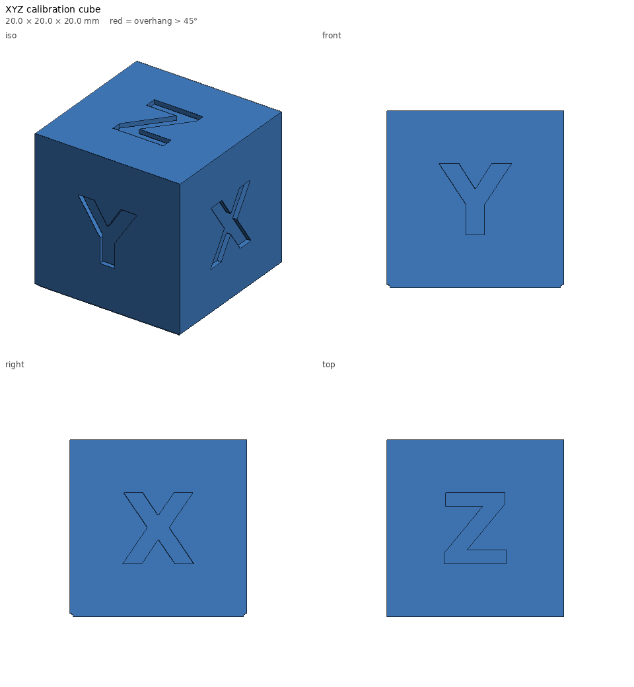

# XYZ calibration cube — print notes

_Generated by `printlib build`; do not edit by hand._

**Printer:** Anycubic Kobra 2 Plus · **Material:** PLA · **Nozzle** 210 °C · **Bed** 60 °C · **Layer** 0.2 mm · **Infill** 15% · **Supports:** no

20 mm cube with engraved axis letters for dimensional calibration.

## Notes

- Measure X/Y above the chamfered first millimetre.
- Letters: Z on top, X on the +X face, Y on the -Y face (front).

## Parameters used

| Param | Value |
|---|---|
| `size` | 20.0 |
| `letter_size` | 8.0 |
| `depth` | 0.6 |

## `calibration-cube.stl`

| Stat | Value |
|---|---|
| dimensions (mm) | 20.00 x 20.00 x 20.00 |
| triangles | 168 |
| volume (cm³) | 7.94 |
| est. PLA (g) | 4.6 |
| est. filament (m) | 1.54 |
| est. print time | 8m |
| bed contact (mm²) | 369 |
| overhang area (mm²) | 37 |

- ℹ️ **fits** — Fits the Anycubic Kobra 2 Plus usable volume [310, 310, 390].
- ℹ️ **minor-overhang** — 37 mm² of tiny ledges/roofs (stair steps, small holes, lettering) — print fine unsupported.
