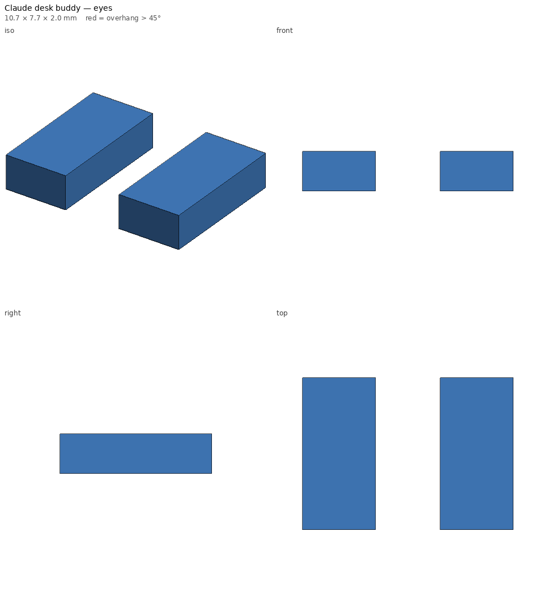

# Claude desk buddy — print notes

_Generated by `printlib build`; do not edit by hand._

**Printer:** Anycubic Kobra 2 Plus · **Material:** PLA · **Nozzle** 210 °C · **Bed** 60 °C · **Layer** 0.2 mm · **Infill** 15% · **Supports:** no

Blocky pixel-art Claude mascot figure for the desk, with optional press-in eye plugs.

## Notes

- Body: terracotta/orange PLA (Claude orange is roughly #D97757). Eyes: black PLA or a paint pen.
- Print the body upright on its feet as exported; no supports or brim needed.
- Eye plugs are tiny: print several copies, or add them to another black print's plate.
- Plugs use the `snug` fit; if they're loose, a drop of CA glue fixes it.

## Parameters used

| Param | Value |
|---|---|
| `scale` | 1.0 |
| `depth` | 22.0 |
| `eye_depth` | 2.0 |
| `eye_plugs` | True |

## `claude-buddy-body.stl`

| Stat | Value |
|---|---|
| dimensions (mm) | 53.98 x 22.00 x 36.00 |
| triangles | 282 |
| volume (cm³) | 33.04 |
| est. PLA (g) | 16.3 |
| est. filament (m) | 5.45 |
| est. print time | 26m |
| bed contact (mm²) | 441 |
| overhang area (mm²) | 543 |

- ℹ️ **fits** — Fits the Anycubic Kobra 2 Plus usable volume [310, 310, 390].
- ℹ️ **minor-overhang** — 87 mm² of tiny ledges/roofs (stair steps, small holes, lettering) — print fine unsupported.
- ℹ️ **bridge** — 5 bridge(s), longest 12.0 mm — OK with good cooling.

## `claude-buddy-eyes.stl`

| Stat | Value |
|---|---|
| dimensions (mm) | 10.70 x 7.70 x 2.00 |
| triangles | 24 |
| volume (cm³) | 0.11 |
| est. PLA (g) | 0.1 |
| est. filament (m) | 0.05 |
| est. print time | 2m |
| bed contact (mm²) | 57 |
| overhang area (mm²) | 0 |

- ℹ️ **multi-body** — 2 separate bodies — fine for a plate of parts; make sure each one touches the bed.
- ℹ️ **fits** — Fits the Anycubic Kobra 2 Plus usable volume [310, 310, 390].
- ℹ️ **no-supports** — No overhangs beyond the limit — prints without supports.
