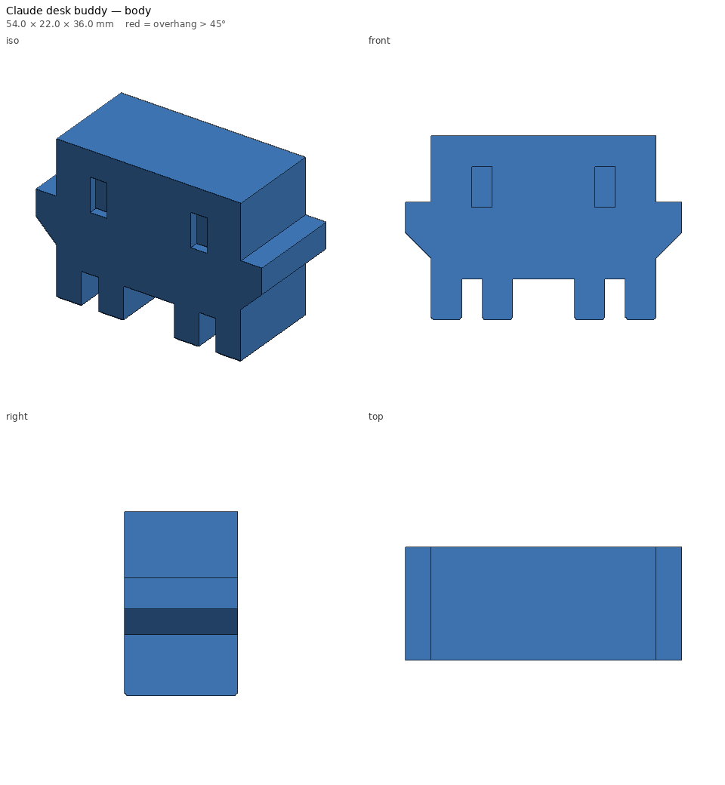

# Claude desk buddy

A chunky pixel-art desk buddy in the style of the little orange Claude Code
mascot: blocky body, two tall eyes, stubby arms, four short legs.



## Printing

- **Body** (`claude-buddy-body.stl`): orange/terracotta PLA, upright on its
  feet as exported. No supports, no brim. The arms have 45° undersides and
  the belly is a short bridge.
- **Eyes** (`claude-buddy-eyes.stl`): two press-in plugs in black PLA. Or
  skip them and fill the eye pockets with a black paint pen.

## Parameters

| Param | Default | Notes |
|---|---|---|
| `scale` | 1.0 | 1.0 ≈ 54 × 22 × 36 mm. 2.0 ≈ 11 cm wide; wide leg gaps get 45° gussets automatically |
| `depth` | 22 | front-to-back thickness (before scaling) |
| `eye_depth` | 2.0 | pocket depth = plug height |
| `eye_plugs` | true | export the eye plugs part |

```bash
python -m printlib build claude-buddy --set scale=2 --out scratch/big-buddy
```

See [PRINT.md](PRINT.md) for time, filament and the printability report.
