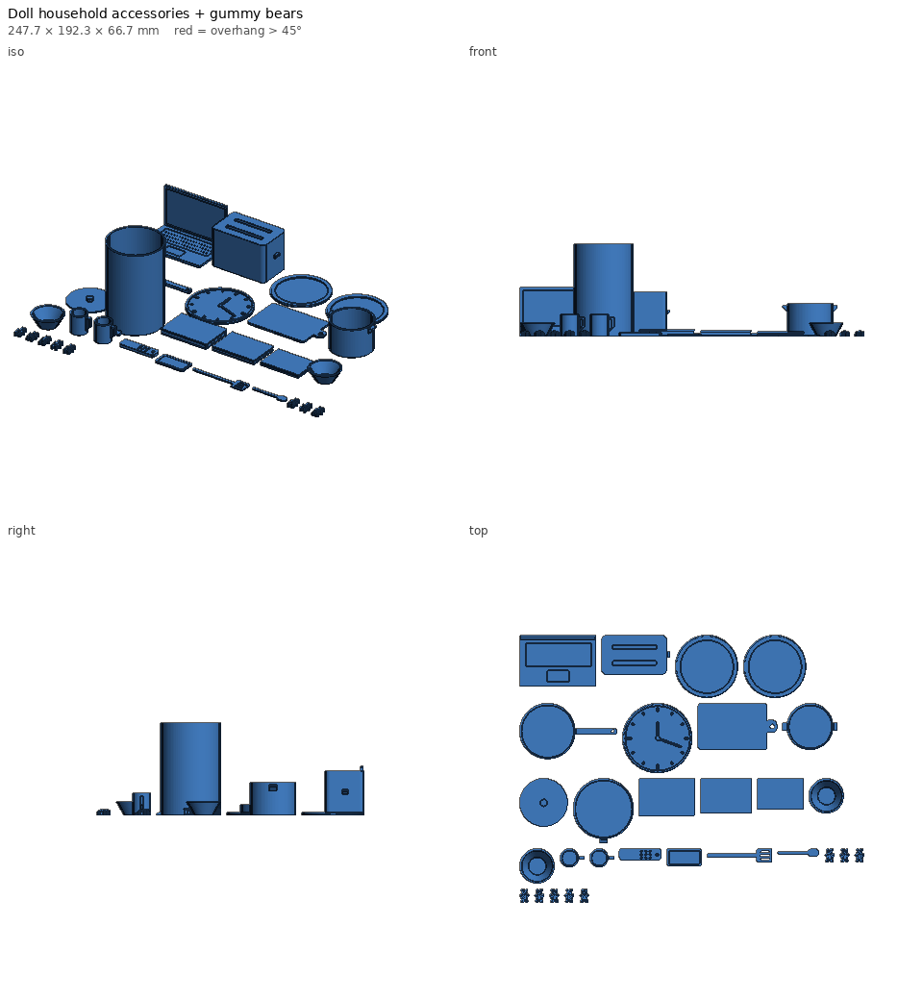

# Doll household accessories + gummy bears — print notes

_Generated by `printlib build`; do not edit by hand._

**Printer:** Anycubic Kobra 2 Plus · **Material:** PLA · **Nozzle** 210 °C · **Bed** 60 °C · **Layer** 0.2 mm · **Infill** 15% · **Supports:** no

One plate of 1:6-scale kitchen and home accessories for Barbie-size dolls, plus 8 gummy bears.

## Notes

- Household set: 2 mugs, 2 plates, 2 bowls, frying pan, pot + lid, toaster, open laptop, phone, TV remote, 3 books, cutting board, spoon, spatula, wall clock, trash can.
- Everything prints in one go, no supports. Use a brim only if your first layer is fussy — the parts are small.
- Set split=true to get the household items and the gummy bears as separate files (e.g. to print the bears in translucent coloured PLA/PETG so they look like real gummies).
- The gummy bears look edible but are plastic and small — keep them away from little kids.
- Engraved details (phone screen, laptop keys, book pages) pop if you wipe on a little acrylic paint.

## Parameters used

| Param | Value |
|---|---|
| `scale` | 6.0 |
| `gummy_count` | 8 |
| `gummy_height` | 10.0 |
| `split` | False |
| `plate_width` | 250.0 |

## `doll-house-accessories.stl`

| Stat | Value |
|---|---|
| dimensions (mm) | 247.68 x 192.30 x 66.67 |
| triangles | 309,086 |
| volume (cm³) | 93.95 |
| est. PLA (g) | 116.5 |
| est. filament (m) | 39.06 |
| est. print time | 2h 55m |
| bed contact (mm²) | 18386 |
| overhang area (mm²) | 1115 |

- ℹ️ **multi-body** — 29 separate bodies — fine for a plate of parts; make sure each one touches the bed.
- ℹ️ **fits** — Fits the Anycubic Kobra 2 Plus usable volume [310, 310, 390].
- ℹ️ **minor-overhang** — 1105 mm² of tiny ledges/roofs (stair steps, small holes, lettering) — print fine unsupported.
- ℹ️ **bridge** — 2 bridge(s), longest 2.0 mm — OK with good cooling.
