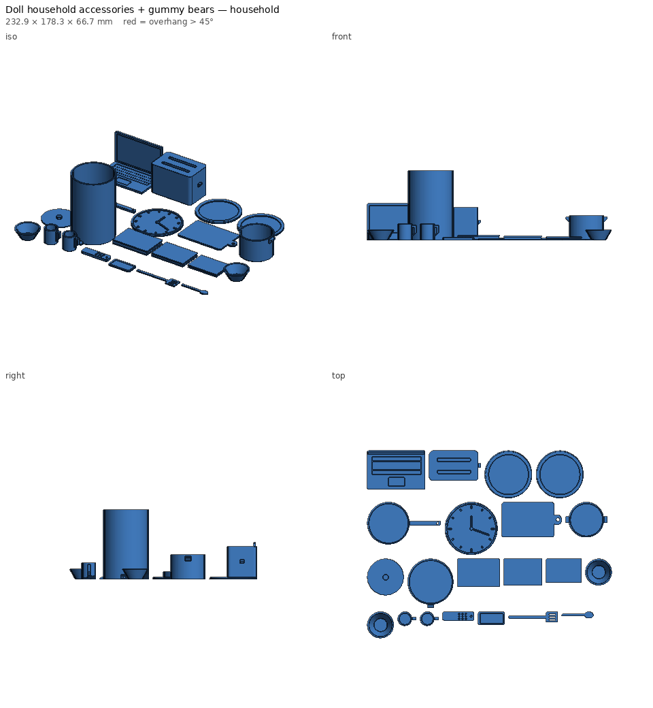
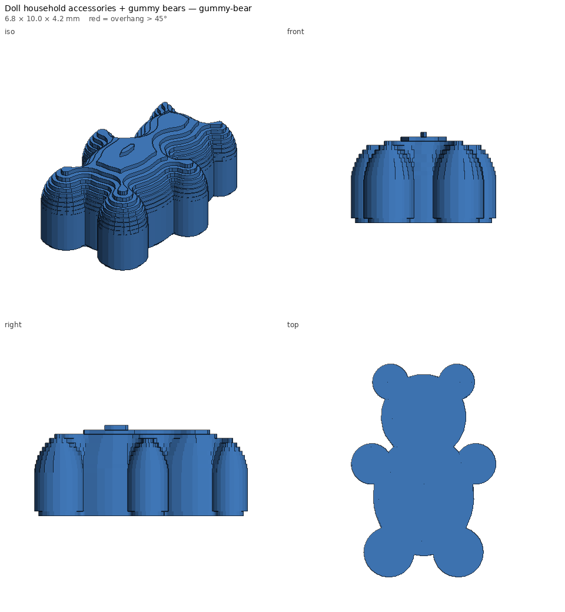

# Doll household accessories + gummy bears

One print plate of 1:6-scale home accessories for Barbie-size (~29 cm)
dolls, plus a little gummy bear to print as many times as you like. Every item is sized from the real object
÷ 6 and shaped to print without supports.





## What's included (two files)

| Kitchen | Home | Treats |
|---|---|---|
| 2 mugs (with handles) | open laptop (keyboard + screen detail) | gummy bear (~10 mm, one per file; duplicate in the slicer) |
| 2 dinner plates | phone | |
| 2 bowls | TV remote | |
| frying pan | 3 books (different sizes) | |
| pot (with handles) + lid | wall clock | |
| toaster (two slots + lever) | trash can | |
| cutting board, spoon, spatula | | |

## Printing

- **`doll-house-accessories-household.stl`**: all 21 household items, about 2h 55m and 115 g of PLA.
- **`doll-house-accessories-gummy-bear.stl`**: **one** gummy bear (6.8 × 10 × 4.2 mm, about 0.2 g).
  Add it to the slicer plate as many times as you want (in Anycubic Slicer Next, right-click > Add
  instance, or copy and paste), and print in translucent red, orange, green or yellow PLA/PETG.
- No supports on either.
- It's a plate of small parts, so a clean, well-levelled first layer matters
  most. Add a brim if small pieces lift.
- Want everything in one file instead? `--set split=false` packs it all on a single plate.
- Engraved details (phone screen, laptop keys, book pages, clock) stand out
  with a quick wash of acrylic paint.
- The gummy bears look like candy but are small plastic parts; keep them away
  from little kids.

## Parameters

| Param | Default | Notes |
|---|---|---|
| `scale` | 6 | real size ÷ scale. 6 = Barbie; 12 ≈ 1:12 dollhouse (check small parts) |
| `gummy_count` | 8 | bears on the combined plate (`split=false` only) |
| `gummy_height` | 10 | mm. 6 is about the smallest that still looks like a bear |
| `split` | true | household plate + a single gummy-bear STL; false = one combined plate |
| `plate_width` | 250 | packing width on the bed |

```bash
python -m printlib build doll-house-accessories --set split=false --set gummy_count=12 --out scratch/one-plate
python -m printlib bundle doll-house-accessories --name doll-house
```

See [PRINT.md](PRINT.md).
