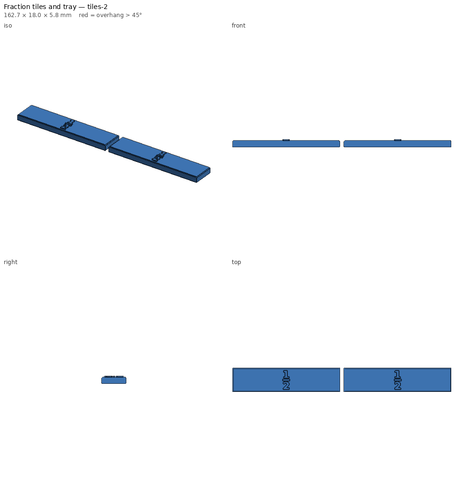
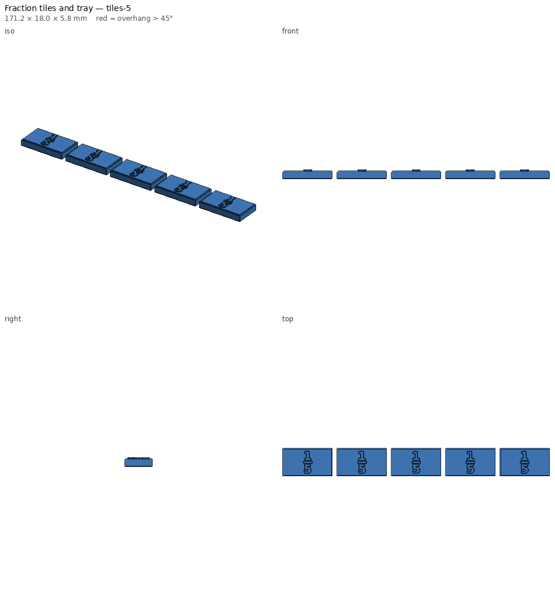
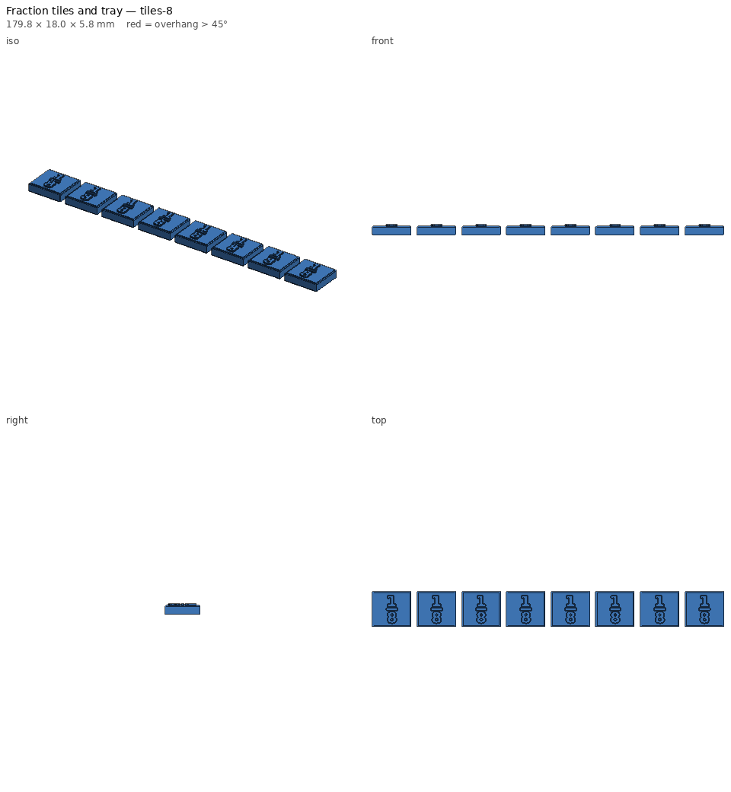
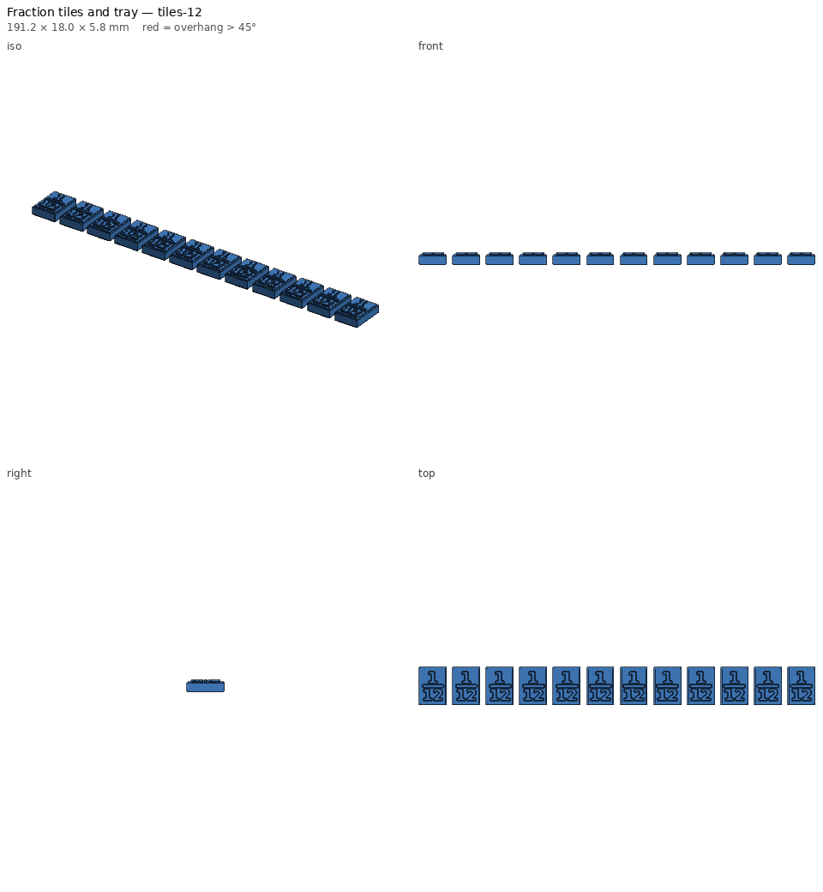
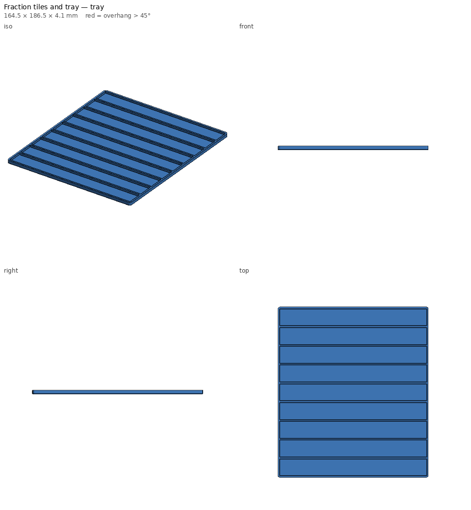

# Fraction tiles and tray — print notes

_Generated by `printlib build`; do not edit by hand._

**Printer:** Anycubic Kobra 2 Plus · **Material:** PLA · **Nozzle** 210 °C · **Bed** 60 °C · **Layer** 0.2 mm · **Infill** 15% · **Supports:** no

Labelled fraction bars (1 to 1/12) with a tray that holds a full set in order.

## Notes

- Print each `tiles-N` file in its own colour; the tray in a neutral colour.
- Tiles are whole/d long minus a 0.15 mm gap so a full row drops into the tray without jamming; twelve twelfths come out ~1.8 mm shorter than the whole bar, which doesn't show in use.
- Labels are raised 0.8 mm so students can feel them; set label_raise=0 for flat tiles.
- Full set: 51 tiles (~3.3 h, ~120 g) + tray (~1.9 h, ~75 g). Print the rows the students need first.

## Parameters used

| Param | Value |
|---|---|
| `denominators` | [1, 2, 3, 4, 5, 6, 8, 10, 12] |
| `whole` | 160.0 |
| `tile_h` | 18.0 |
| `tile_t` | 5.0 |
| `gap` | 0.15 |
| `label_size` | 5.5 |
| `label_raise` | 0.8 |
| `tray` | True |
| `tray_wall` | 2.0 |
| `tray_floor` | 1.6 |

## `fraction-tiles-tiles-1.stl`

| Stat | Value |
|---|---|
| dimensions (mm) | 159.85 x 18.00 x 5.80 |
| triangles | 820 |
| volume (cm³) | 14.28 |
| est. PLA (g) | 12.2 |
| est. filament (m) | 4.09 |
| est. print time | 20m |
| bed contact (mm²) | 2736 |
| overhang area (mm²) | 142 |

- ℹ️ **fits** — Fits the Anycubic Kobra 2 Plus usable volume [310, 310, 390].
- ℹ️ **minor-overhang** — 142 mm² of tiny ledges/roofs (stair steps, small holes, lettering) — print fine unsupported.

## `fraction-tiles-tiles-2.stl`

| Stat | Value |
|---|---|
| dimensions (mm) | 162.70 x 18.00 x 5.80 |
| triangles | 4,112 |
| volume (cm³) | 14.30 |
| est. PLA (g) | 12.5 |
| est. filament (m) | 4.20 |
| est. print time | 20m |
| bed contact (mm²) | 2719 |
| overhang area (mm²) | 155 |

- ℹ️ **multi-body** — 2 separate bodies — fine for a plate of parts; make sure each one touches the bed.
- ℹ️ **fits** — Fits the Anycubic Kobra 2 Plus usable volume [310, 310, 390].
- ℹ️ **minor-overhang** — 155 mm² of tiny ledges/roofs (stair steps, small holes, lettering) — print fine unsupported.

## `fraction-tiles-tiles-3.stl`

| Stat | Value |
|---|---|
| dimensions (mm) | 165.55 x 18.00 x 5.80 |
| triangles | 7,116 |
| volume (cm³) | 14.31 |
| est. PLA (g) | 12.8 |
| est. filament (m) | 4.29 |
| est. print time | 21m |
| bed contact (mm²) | 2703 |
| overhang area (mm²) | 169 |

- ℹ️ **multi-body** — 3 separate bodies — fine for a plate of parts; make sure each one touches the bed.
- ℹ️ **fits** — Fits the Anycubic Kobra 2 Plus usable volume [310, 310, 390].
- ℹ️ **minor-overhang** — 169 mm² of tiny ledges/roofs (stair steps, small holes, lettering) — print fine unsupported.

## `fraction-tiles-tiles-4.stl`

| Stat | Value |
|---|---|
| dimensions (mm) | 168.40 x 18.00 x 5.80 |
| triangles | 7,800 |
| volume (cm³) | 14.32 |
| est. PLA (g) | 13.1 |
| est. filament (m) | 4.38 |
| est. print time | 21m |
| bed contact (mm²) | 2687 |
| overhang area (mm²) | 183 |

- ℹ️ **multi-body** — 4 separate bodies — fine for a plate of parts; make sure each one touches the bed.
- ℹ️ **fits** — Fits the Anycubic Kobra 2 Plus usable volume [310, 310, 390].
- ℹ️ **minor-overhang** — 183 mm² of tiny ledges/roofs (stair steps, small holes, lettering) — print fine unsupported.

## `fraction-tiles-tiles-5.stl`

| Stat | Value |
|---|---|
| dimensions (mm) | 171.25 x 18.00 x 5.80 |
| triangles | 11,030 |
| volume (cm³) | 14.32 |
| est. PLA (g) | 13.4 |
| est. filament (m) | 4.48 |
| est. print time | 21m |
| bed contact (mm²) | 2670 |
| overhang area (mm²) | 196 |

- ℹ️ **multi-body** — 5 separate bodies — fine for a plate of parts; make sure each one touches the bed.
- ℹ️ **fits** — Fits the Anycubic Kobra 2 Plus usable volume [310, 310, 390].
- ℹ️ **minor-overhang** — 196 mm² of tiny ledges/roofs (stair steps, small holes, lettering) — print fine unsupported.

## `fraction-tiles-tiles-6.stl`

| Stat | Value |
|---|---|
| dimensions (mm) | 174.10 x 18.00 x 5.80 |
| triangles | 12,216 |
| volume (cm³) | 14.34 |
| est. PLA (g) | 13.6 |
| est. filament (m) | 4.58 |
| est. print time | 22m |
| bed contact (mm²) | 2654 |
| overhang area (mm²) | 210 |

- ℹ️ **multi-body** — 6 separate bodies — fine for a plate of parts; make sure each one touches the bed.
- ℹ️ **fits** — Fits the Anycubic Kobra 2 Plus usable volume [310, 310, 390].
- ℹ️ **minor-overhang** — 210 mm² of tiny ledges/roofs (stair steps, small holes, lettering) — print fine unsupported.

## `fraction-tiles-tiles-8.stl`

| Stat | Value |
|---|---|
| dimensions (mm) | 179.80 x 18.00 x 5.80 |
| triangles | 17,152 |
| volume (cm³) | 14.36 |
| est. PLA (g) | 14.2 |
| est. filament (m) | 4.76 |
| est. print time | 23m |
| bed contact (mm²) | 2621 |
| overhang area (mm²) | 237 |

- ℹ️ **multi-body** — 8 separate bodies — fine for a plate of parts; make sure each one touches the bed.
- ℹ️ **fits** — Fits the Anycubic Kobra 2 Plus usable volume [310, 310, 390].
- ℹ️ **minor-overhang** — 237 mm² of tiny ledges/roofs (stair steps, small holes, lettering) — print fine unsupported.

## `fraction-tiles-tiles-10.stl`

| Stat | Value |
|---|---|
| dimensions (mm) | 185.50 x 18.00 x 5.80 |
| triangles | 24,620 |
| volume (cm³) | 14.55 |
| est. PLA (g) | 15.1 |
| est. filament (m) | 5.07 |
| est. print time | 24m |
| bed contact (mm²) | 2589 |
| overhang area (mm²) | 264 |

- ℹ️ **multi-body** — 10 separate bodies — fine for a plate of parts; make sure each one touches the bed.
- ℹ️ **fits** — Fits the Anycubic Kobra 2 Plus usable volume [310, 310, 390].
- ℹ️ **minor-overhang** — 264 mm² of tiny ledges/roofs (stair steps, small holes, lettering) — print fine unsupported.

## `fraction-tiles-tiles-12.stl`

| Stat | Value |
|---|---|
| dimensions (mm) | 191.20 x 18.00 x 5.80 |
| triangles | 33,432 |
| volume (cm³) | 14.57 |
| est. PLA (g) | 15.7 |
| est. filament (m) | 5.28 |
| est. print time | 25m |
| bed contact (mm²) | 2556 |
| overhang area (mm²) | 292 |

- ℹ️ **multi-body** — 12 separate bodies — fine for a plate of parts; make sure each one touches the bed.
- ℹ️ **fits** — Fits the Anycubic Kobra 2 Plus usable volume [310, 310, 390].
- ℹ️ **minor-overhang** — 292 mm² of tiny ledges/roofs (stair steps, small holes, lettering) — print fine unsupported.

## `fraction-tiles-tray.stl`

| Stat | Value |
|---|---|
| dimensions (mm) | 164.50 x 186.50 x 4.10 |
| triangles | 1,340 |
| volume (cm³) | 58.86 |
| est. PLA (g) | 73.0 |
| est. filament (m) | 24.47 |
| est. print time | 1h 51m |
| bed contact (mm²) | 30393 |
| overhang area (mm²) | 278 |

- ℹ️ **fits** — Fits the Anycubic Kobra 2 Plus usable volume [310, 310, 390].
- ℹ️ **minor-overhang** — 278 mm² of tiny ledges/roofs (stair steps, small holes, lettering) — print fine unsupported.
