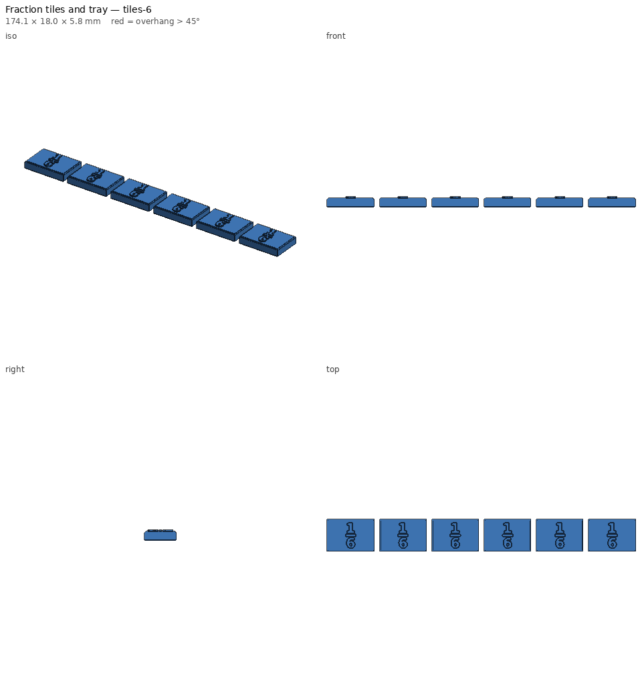

# Fraction tiles and tray

Fraction bars for 1, ½, ⅓, ¼, ⅕, ⅙, ⅛, 1/10 and 1/12, the denominators in the
4th-grade standards. Each tile is exactly its fraction of the 160 mm whole,
so students can lay ½ next to 2 × ¼ or 3 × ⅙ and see that they match. The
tray holds a full set in order and doubles as a work mat.



## Lesson ideas

- **Equivalence:** which rows can exactly cover ½? ⅔?
- **Comparing:** is ⅗ or ⅝ longer? Line them up.
- **Adding like denominators:** ⅜ + ⅜, then compare to ¾.
- **Benchmarks:** is this fraction more or less than ½?

## Printing

| File | Tiles | Time | PLA |
|---|---|---|---|
| `fraction-tiles-tiles-1.stl` … `tiles-12.stl` | 1 per row | ~20–25 min each | ~12–16 g each |
| `fraction-tiles-tray.stl` | tray | ~1 h 50 min | ~75 g |

- Print each row in its **own colour**; most commercial sets do this, and
  students start to recognise "the purple ones are eighths".
- Labels are raised stacked fractions (0.8 mm), readable by touch.
- No supports.

## Parameters

`denominators`, `whole` (length of the 1 bar), `tile_h`, `tile_t`, `gap`,
`label_size`, `label_raise`, `tray`, `tray_wall`, `tray_floor`.

```bash
# Only halves, fourths, eighths, at a smaller size
python -m printlib build fraction-tiles --set "denominators=[1, 2, 4, 8]" --set whole=120 --out scratch/fractions-248
```

See [PRINT.md](PRINT.md).
