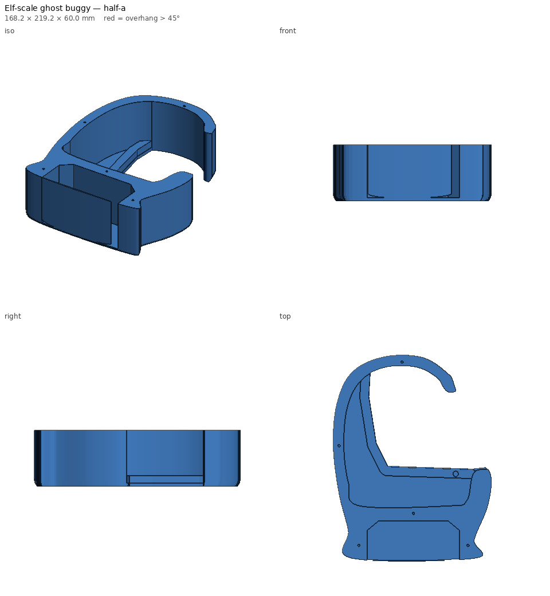
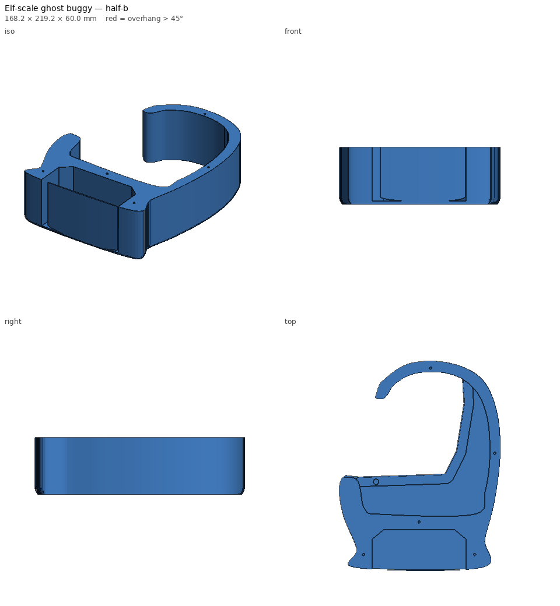
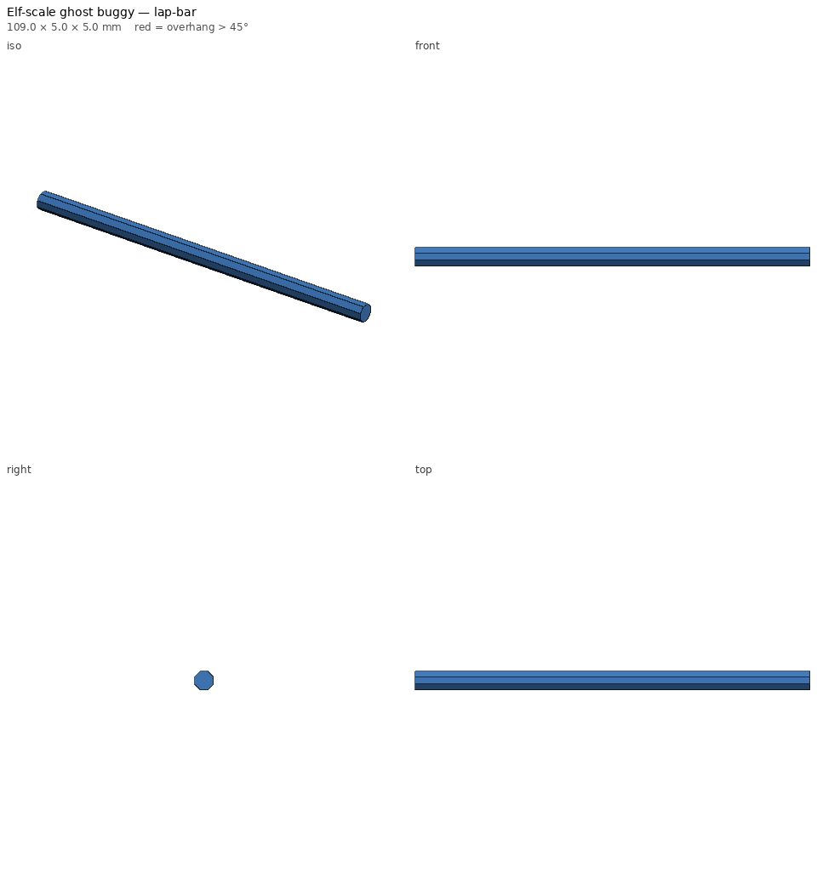

# Elf-scale ghost buggy — print notes

_Generated by `printlib build`; do not edit by hand._

**Printer:** Anycubic Kobra 2 Plus · **Material:** PLA · **Nozzle** 210 °C · **Bed** 60 °C · **Layer** 0.2 mm · **Infill** 12% · **Supports:** no

Original clamshell-style haunted-ride car sized for a 30 cm shelf elf: two glue-together halves plus a drop-in lap bar.

## Notes

- Default size ≈ 170 mm deep × 214 mm tall × 120 mm wide; the seat is ~56 mm up with ~147 mm of headroom under the hood and ~112 mm between the side walls — room for one elf (or two snug ones).
- Print each half lying on its outer side, as exported. One half per plate is easiest (~170 × 214 mm footprint, 60 mm tall).
- Classic look: black or dark-purple PLA, then a silver/gold paint pen along the hood edge and armrests. Silk or glow-in-the-dark PLA also looks great.
- Assembly: drop the lap bar's ends into the sockets on top of both armrest rails, push 1.75 mm filament pins (5 pieces, ~11 mm) into the holes on one half's centre face, press the halves together and glue (CA or PLA-safe glue).
- The flat centre faces are the glue joint; a light sand of the seam down the back and hood, then paint, hides it.
- Low infill is fine (it's a display piece); the walls give it the strength.

## Parameters used

| Param | Value |
|---|---|
| `scale` | 1.0 |
| `width` | 120.0 |
| `side_wall` | 4.0 |
| `roundover` | 12.0 |
| `pin_d` | 1.75 |
| `lap_bar` | True |

## `ghost-buggy-half-a.stl`

| Stat | Value |
|---|---|
| dimensions (mm) | 168.20 x 219.15 x 60.00 |
| triangles | 47,672 |
| volume (cm³) | 540.01 |
| est. PLA (g) | 234.1 |
| est. filament (m) | 78.49 |
| est. print time | 5h 51m |
| bed contact (mm²) | 18217 |
| overhang area (mm²) | 1942 |

- ℹ️ **fits** — Fits the Anycubic Kobra 2 Plus usable volume [310, 310, 390].
- ℹ️ **minor-overhang** — 1942 mm² of tiny ledges/roofs (stair steps, small holes, lettering) — print fine unsupported.

## `ghost-buggy-half-b.stl`

| Stat | Value |
|---|---|
| dimensions (mm) | 168.20 x 219.15 x 60.00 |
| triangles | 47,672 |
| volume (cm³) | 540.01 |
| est. PLA (g) | 234.1 |
| est. filament (m) | 78.49 |
| est. print time | 5h 51m |
| bed contact (mm²) | 18217 |
| overhang area (mm²) | 1942 |

- ℹ️ **fits** — Fits the Anycubic Kobra 2 Plus usable volume [310, 310, 390].
- ℹ️ **minor-overhang** — 1942 mm² of tiny ledges/roofs (stair steps, small holes, lettering) — print fine unsupported.

## `ghost-buggy-lap-bar.stl`

| Stat | Value |
|---|---|
| dimensions (mm) | 109.00 x 5.00 x 5.00 |
| triangles | 28 |
| volume (cm³) | 2.26 |
| est. PLA (g) | 2.8 |
| est. filament (m) | 0.92 |
| est. print time | 6m |
| bed contact (mm²) | 226 |
| overhang area (mm²) | 0 |

- ℹ️ **fits** — Fits the Anycubic Kobra 2 Plus usable volume [310, 310, 390].
- ℹ️ **no-supports** — No overhangs beyond the limit — prints without supports.
