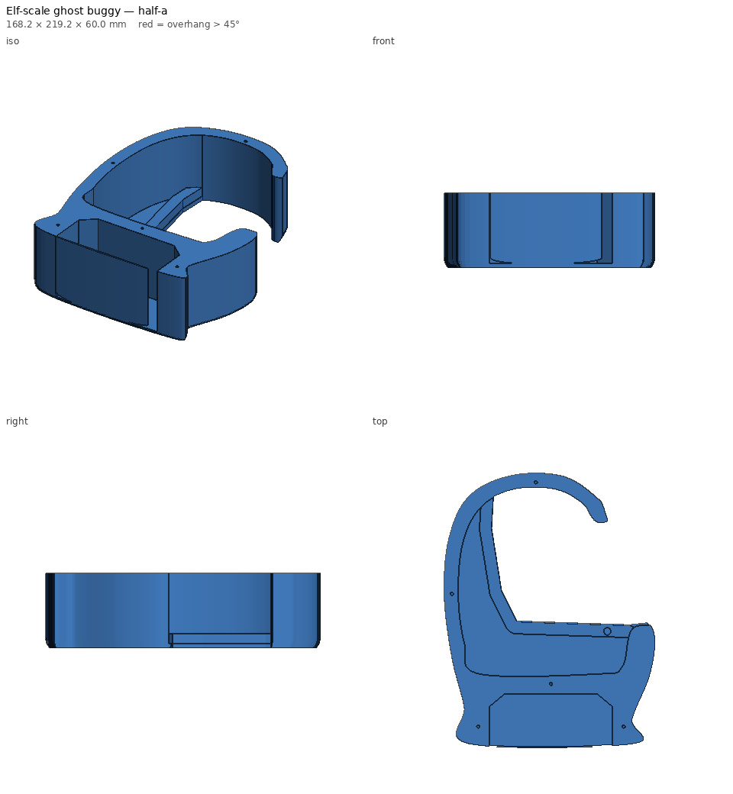

# Elf-scale ghost buggy

An original clamshell-style haunted-ride car for a ~30 cm shelf elf, in the
spirit of classic dark-ride vehicles: a tall egg-shaped back, a hood that
curls over the rider's head, sides that open above the armrests, a knee
panel, a drop-in lap bar and a pinched pedestal base. About
168 × 120 × 219 mm, with a seat ~56 mm up, ~147 mm of headroom and
~112 mm between the side walls: one elf, or two snug ones.



## Parts

| File | Print | Notes |
|---|---|---|
| `ghost-buggy-half-a.stl` | lying on its outer side, as exported | ~234 g, ~5h 50m |
| `ghost-buggy-half-b.stl` | lying on its outer side, as exported | the mirrored other half |
| `ghost-buggy-lap-bar.stl` | flat, as exported | octagonal rod, ~6 min |

No supports, no brim. Each half is a set of side profiles extruded straight
up to the centre plane, and the outer side's rounded edge never gets flatter
than 45°. One half per plate is easiest.

## Assembly

1. Drop the lap bar's ends into the sockets on top of each armrest rail.
2. Push five ~11 mm pieces of 1.75 mm filament into the pin holes on one
   half's flat centre face.
3. Press the halves together (the bar gets trapped between them) and glue
   with CA or a PLA-safe glue. Clamp or weight it for a few minutes.
4. Lightly sand the seam down the back and hood, then paint.

**Look:** black or dark-purple PLA, with a silver or gold paint pen along the
hood edge and armrests. Silk or glow-in-the-dark PLA is fun too.

## Parameters

| Param | Default | Notes |
|---|---|---|
| `scale` | 1.0 | 0.6 makes a ~13 cm desk ornament |
| `width` | 120 | total outside width; each half is `width/2` thick |
| `side_wall` | 4 | side wall thickness under the armrests |
| `roundover` | 12 | radius of the rounded outer edge (45°-limited) |
| `pin_d` | 1.75 | alignment pin diameter (filament) |
| `lap_bar` | true | export the lap bar |

```bash
python -m printlib build ghost-buggy --set width=140 --out scratch/wide-buggy   # roomier two-seater
```

See [PRINT.md](PRINT.md) for time, filament and the printability report.
