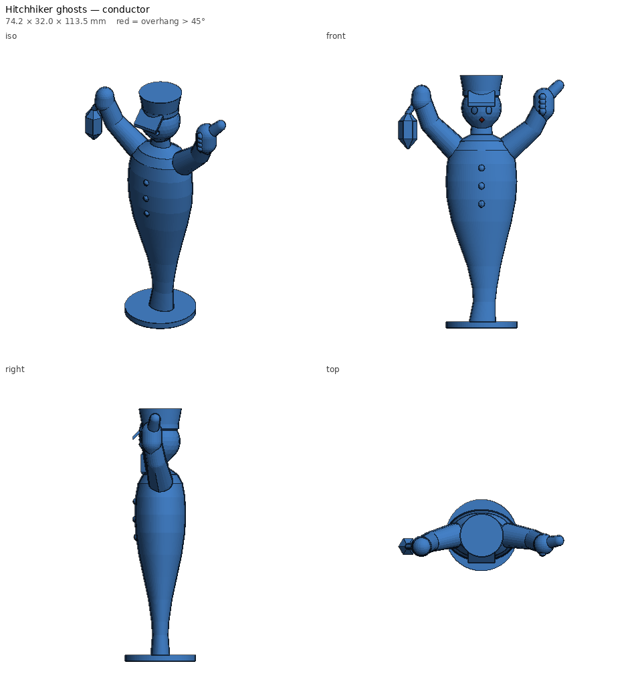
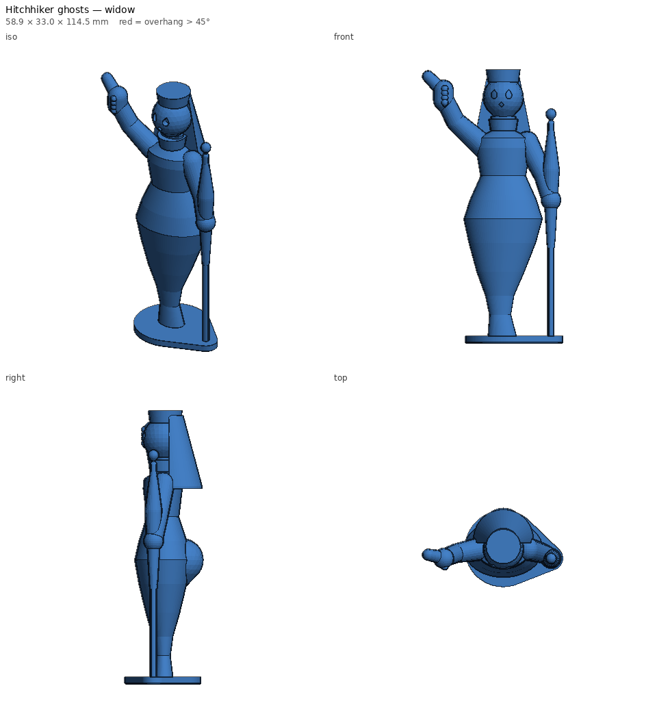
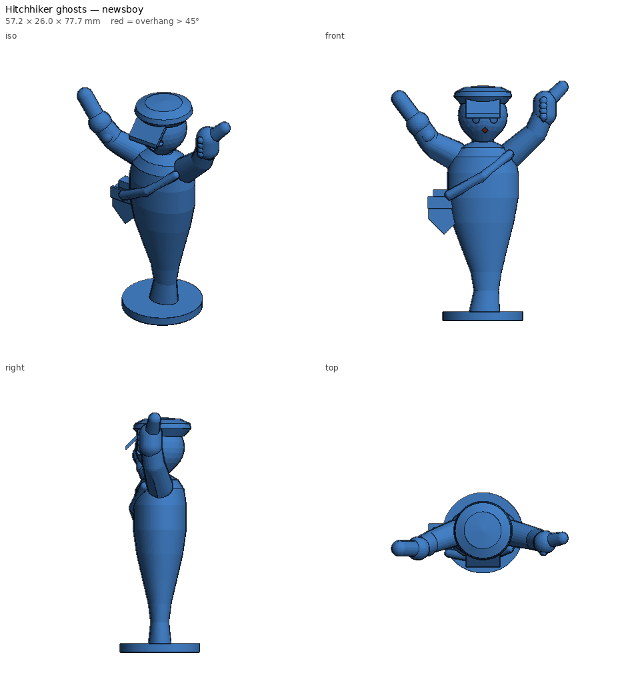

# Hitchhiker ghosts — print notes

_Generated by `printlib build`; do not edit by hand._

**Printer:** Anycubic Kobra 2 Plus · **Material:** PLA · **Nozzle** 210 °C · **Bed** 60 °C · **Layer** 0.2 mm · **Infill** 15% · **Supports:** no

Original trio of Victorian phantoms thumbing a ride (conductor with lantern, veiled widow with parasol, newsboy with satchel), elf-scale, support-free.

## Notes

- Heights at scale 1: conductor ~116 mm, widow ~119 mm, newsboy ~76 mm — they fit in the ghost buggy beside an elf.
- Print upright as exported, no supports. All three fit on one plate.
- Glow-in-the-dark, white or translucent PLA. A black paint pen (or acrylic wash) in the eyes and mouth makes the faces pop; a grey wash over the coat, dress and cap brings out the clothing.
- Glow PLA is abrasive: fine for a one-off on the stock brass nozzle, but use a hardened nozzle if you print a lot of it.
- Checker WARNs (small, accepted for now): ~6 mm² near the top of the conductor's lantern and ~12 mm² on the newsboy around face height. Both are tiny ledges that bridge fine unsupported; worth a look if those spots print rough.
- Thumbs, the parasol and the lantern hanger are the most delicate bits; 3 walls (and 0.12–0.16 mm layers if you like) keep them crisp.

## Parameters used

| Param | Value |
|---|---|
| `scale` | 1.0 |
| `eye_depth` | 2.5 |

## `hitchhiker-ghosts-conductor.stl`

| Stat | Value |
|---|---|
| dimensions (mm) | 74.25 x 32.00 x 113.50 |
| triangles | 9,496 |
| volume (cm³) | 38.31 |
| est. PLA (g) | 21.4 |
| est. filament (m) | 7.19 |
| est. print time | 34m |
| bed contact (mm²) | 764 |
| overhang area (mm²) | 57 |

- ⚠️ **overhang** — 6 mm² steeper than 45° in 1 region(s) (z≈93.3). Add supports, chamfer to 45°, or re-orient (`printlib orient`).
- ℹ️ **fits** — Fits the Anycubic Kobra 2 Plus usable volume [310, 310, 390].
- ℹ️ **minor-overhang** — 51 mm² of tiny ledges/roofs (stair steps, small holes, lettering) — print fine unsupported.

## `hitchhiker-ghosts-widow.stl`

| Stat | Value |
|---|---|
| dimensions (mm) | 58.90 x 33.00 x 114.53 |
| triangles | 9,730 |
| volume (cm³) | 38.92 |
| est. PLA (g) | 22.5 |
| est. filament (m) | 7.53 |
| est. print time | 35m |
| bed contact (mm²) | 889 |
| overhang area (mm²) | 224 |

- ℹ️ **fits** — Fits the Anycubic Kobra 2 Plus usable volume [310, 310, 390].
- ℹ️ **minor-overhang** — 7 mm² of tiny ledges/roofs (stair steps, small holes, lettering) — print fine unsupported.
- ℹ️ **bridge** — 3 bridge(s), longest 8.2 mm — OK with good cooling.

## `hitchhiker-ghosts-newsboy.stl`

| Stat | Value |
|---|---|
| dimensions (mm) | 57.21 x 26.00 x 77.71 |
| triangles | 9,032 |
| volume (cm³) | 17.06 |
| est. PLA (g) | 11.7 |
| est. filament (m) | 3.94 |
| est. print time | 19m |
| bed contact (mm²) | 498 |
| overhang area (mm²) | 35 |

- ⚠️ **overhang** — 12 mm² steeper than 45° in 1 region(s) (z≈68.0). Add supports, chamfer to 45°, or re-orient (`printlib orient`).
- ℹ️ **fits** — Fits the Anycubic Kobra 2 Plus usable volume [310, 310, 390].
- ℹ️ **minor-overhang** — 22 mm² of tiny ledges/roofs (stair steps, small holes, lettering) — print fine unsupported.
