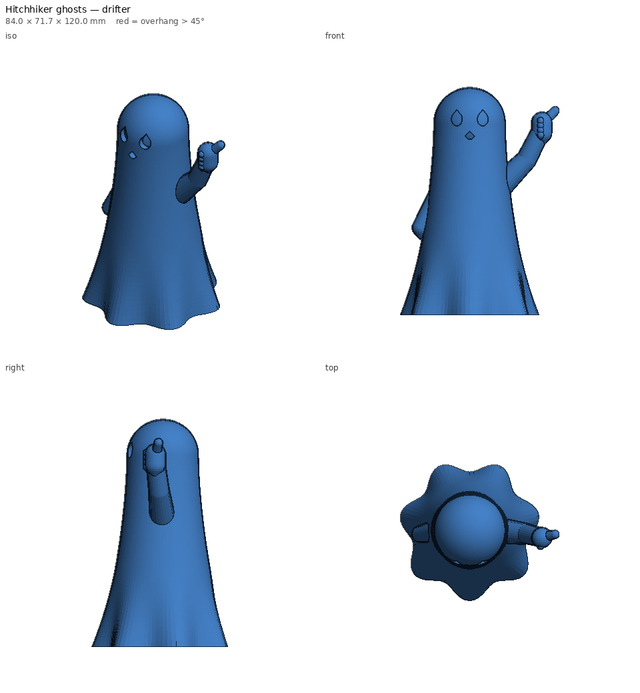
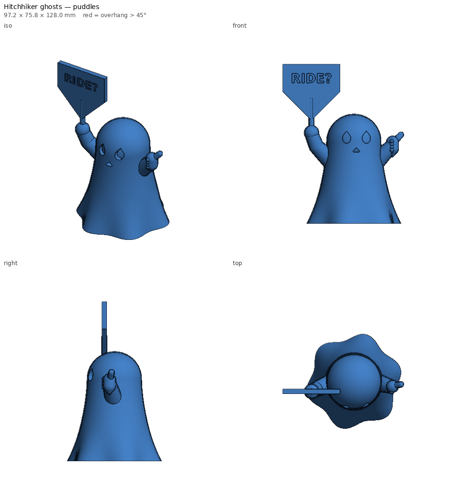
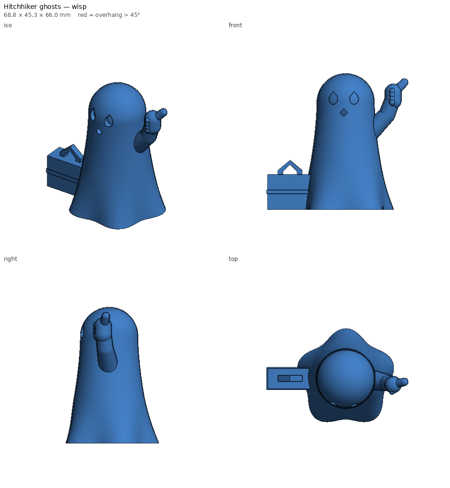

# Hitchhiker ghosts — print notes

_Generated by `printlib build`; do not edit by hand._

**Printer:** Anycubic Kobra 2 Plus · **Material:** PLA · **Nozzle** 210 °C · **Bed** 60 °C · **Layer** 0.2 mm · **Infill** 15% · **Supports:** no

Original trio of little sheet ghosts thumbing a ride (tall, round with a sign, tiny with a suitcase), elf-scale, support-free.

## Notes

- Sizes at scale 1: drifter ~120 mm tall, puddles ~88 mm, wisp ~66 mm — they fit in the ghost buggy beside an elf.
- Print upright as exported, no supports. All three fit on one plate.
- Glow-in-the-dark or white/translucent PLA. A black paint pen (or acrylic wash) in the eyes, mouth and sign letters makes the faces pop.
- Glow PLA is abrasive: fine for a one-off on the stock brass nozzle, but use a hardened nozzle if you print a lot of it.
- Checker WARN (puddles, ~16 mm² at the sign): the flat tops of the 0.8 mm-deep engraved letters on the vertical sign. They're sub-millimetre bridges and print cleanly without support; accepted.
- Thumbs and the sign stick are the most delicate bits; 3 walls (and 0.12–0.16 mm layers if you like) keep them crisp.

## Parameters used

| Param | Value |
|---|---|
| `scale` | 1.0 |
| `sign_text` | RIDE? |
| `eye_depth` | 3.0 |

## `hitchhiker-ghosts-drifter.stl`

| Stat | Value |
|---|---|
| dimensions (mm) | 83.97 x 71.72 x 120.00 |
| triangles | 14,700 |
| volume (cm³) | 216.44 |
| est. PLA (g) | 70.3 |
| est. filament (m) | 23.56 |
| est. print time | 1h 46m |
| bed contact (mm²) | 3645 |
| overhang area (mm²) | 5 |

- ℹ️ **fits** — Fits the Anycubic Kobra 2 Plus usable volume [310, 310, 390].
- ℹ️ **minor-overhang** — 5 mm² of tiny ledges/roofs (stair steps, small holes, lettering) — print fine unsupported.

## `hitchhiker-ghosts-puddles.stl`

| Stat | Value |
|---|---|
| dimensions (mm) | 97.20 x 75.84 x 128.00 |
| triangles | 15,682 |
| volume (cm³) | 190.10 |
| est. PLA (g) | 66.5 |
| est. filament (m) | 22.30 |
| est. print time | 1h 41m |
| bed contact (mm²) | 4081 |
| overhang area (mm²) | 39 |

- ⚠️ **overhang** — 16 mm² steeper than 45° in 3 region(s) (z≈120.4, 120.6, 120.7). Add supports, chamfer to 45°, or re-orient (`printlib orient`).
- ℹ️ **fits** — Fits the Anycubic Kobra 2 Plus usable volume [310, 310, 390].
- ℹ️ **minor-overhang** — 18 mm² of tiny ledges/roofs (stair steps, small holes, lettering) — print fine unsupported.
- ℹ️ **bridge** — 1 bridge(s), longest 1.0 mm — OK with good cooling.

## `hitchhiker-ghosts-wisp.stl`

| Stat | Value |
|---|---|
| dimensions (mm) | 68.76 x 45.30 x 66.00 |
| triangles | 14,464 |
| volume (cm³) | 58.06 |
| est. PLA (g) | 23.9 |
| est. filament (m) | 8.01 |
| est. print time | 37m |
| bed contact (mm²) | 1689 |
| overhang area (mm²) | 23 |

- ℹ️ **fits** — Fits the Anycubic Kobra 2 Plus usable volume [310, 310, 390].
- ℹ️ **minor-overhang** — 23 mm² of tiny ledges/roofs (stair steps, small holes, lettering) — print fine unsupported.
