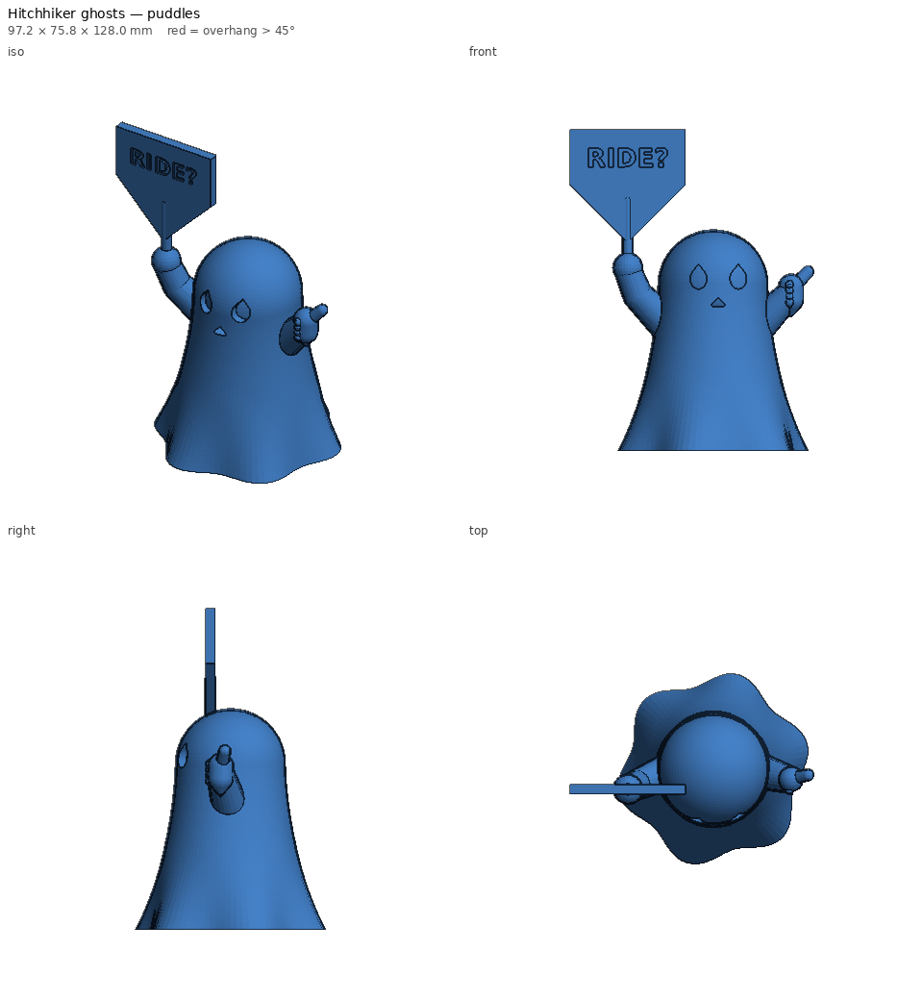

# Hitchhiker ghosts

An original trio of little sheet ghosts thumbing a ride, sized to stand
beside (or squeeze into the [ghost buggy](../ghost-buggy/) with) a ~30 cm
shelf elf.

| Ghost | Height | Personality |
|---|---|---|
| **Drifter** | ~120 mm | tall and wavy, thumb out, other arm hanging loose |
| **Puddles** | ~128 mm with sign (88 mm body) | short and round, holding up a "RIDE?" sign |
| **Wisp** | ~66 mm | tiny, thumb out, suitcase packed |



## Printing

Print upright as exported, with no supports or brim. All three fit on one
plate (~258 × 76 mm). Total ≈ 160 g and ~4 hours.

They're built to print support-free. The bodies only narrow going up, and
every arm, fist and blob has a 45° keel underneath. The eyes are teardrops
and the mouths are diamonds, so the pockets have pointed roofs instead of
flat ceilings. The one checker WARN is the flat tops of the sign's engraved
letters: sub-millimetre bridges that print fine.

**Material:** glow-in-the-dark PLA is the obvious choice (it's mildly
abrasive, which is fine for a few prints on the stock nozzle). White or
translucent PLA works too. Run a black paint pen or acrylic wash into the
eyes, mouth and sign letters.

## Parameters

| Param | Default | Notes |
|---|---|---|
| `scale` | 1.0 | 0.6 for desk / dollhouse-sized ghosts |
| `sign_text` | `RIDE?` | text on Puddles' sign; keep it ≤ ~6 characters |
| `eye_depth` | 3.0 | depth of the eye and mouth pockets |

```bash
python -m printlib build hitchhiker-ghosts --set sign_text=BOO! --out scratch/boo
```

See [PRINT.md](PRINT.md) for time, filament and the printability report.
