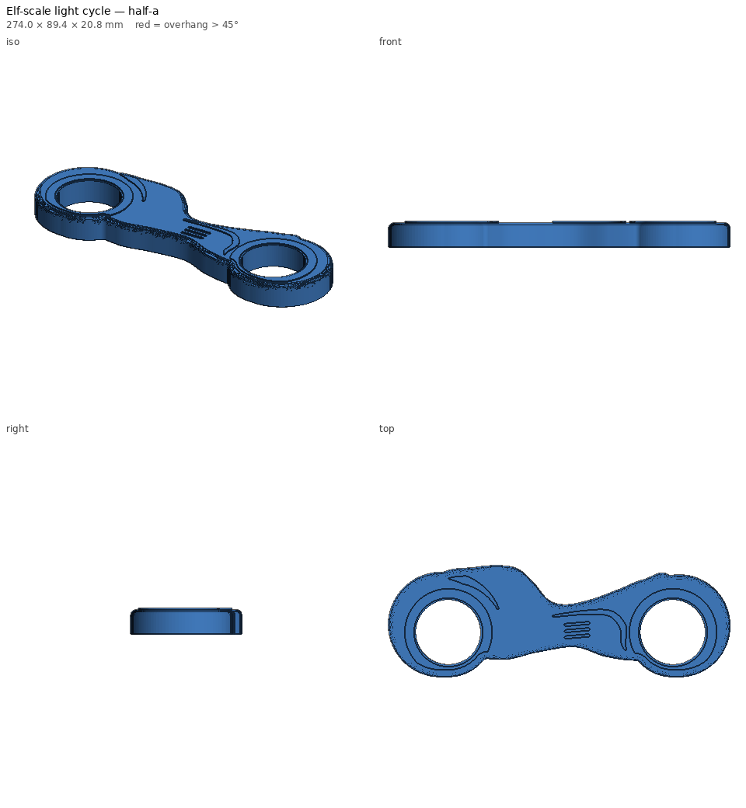
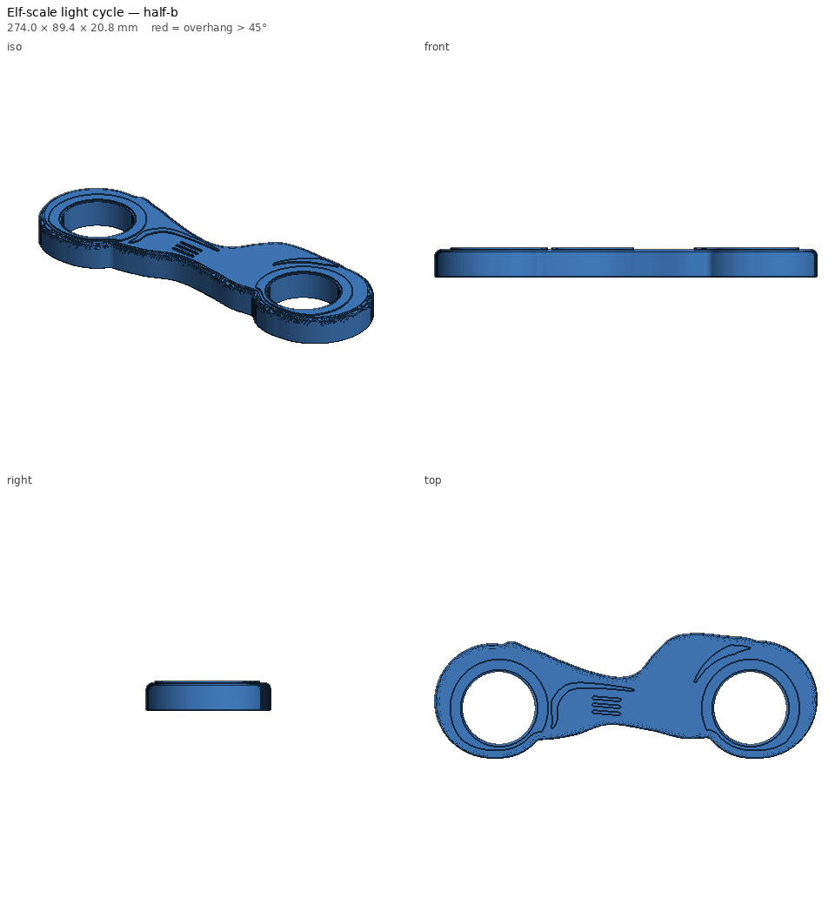
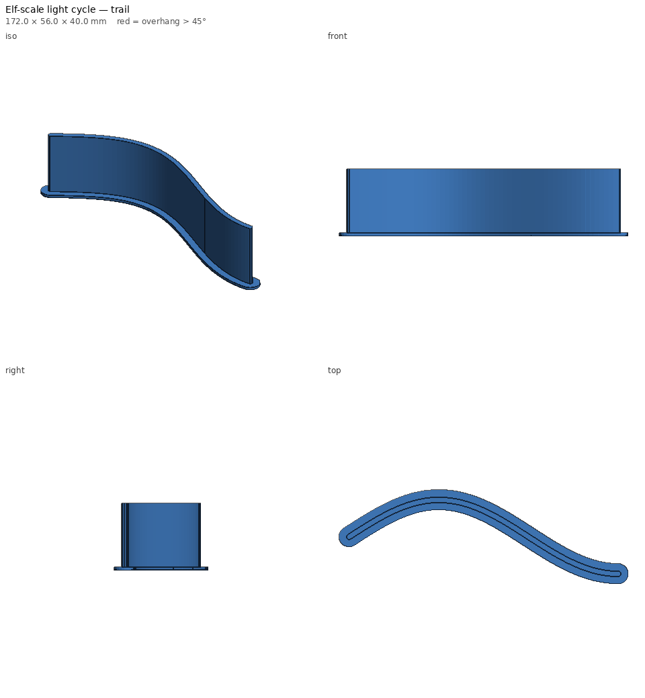

# Elf-scale light cycle — print notes

_Generated by `printlib build`; do not edit by hand._

**Printer:** Anycubic Kobra 2 Plus · **Material:** PLA · **Nozzle** 210 °C · **Bed** 60 °C · **Layer** 0.2 mm · **Infill** 15% · **Supports:** no

Replica-style light cycle sized for a 30 cm shelf elf: hubless glowing wheels, two glue-together halves with two-colour glow accents, plus an optional curved light-ribbon trail.

## Notes

- Default size ≈ 274 mm long × 89 mm tall × 42 mm wide; the seat dip is ~60 mm up for a ~30 cm elf to straddle (or lie forward, rider-style).
- Print both halves flat as exported (inner face on the bed). They fit on one plate together (~274 × 185 mm).
- Two-colour stripes: add a filament change / pause at the slab top (Z = half_width, 20.0 mm by default). In Anycubic Slicer Next: preview slider → right-click the first layer above 20.0 mm → Add color change (M600) or Add pause. Start in black, swap to cyan (classic) or orange (villain) PLA.
- The outer roundover prints as 0.2 mm stair steps; the last few layers before the flat top are wide, thin top-surface rings — normal, no support needed. 0.12–0.16 mm layers make the curve smoother if you want it glossier.
- Assembly: cut 3 pieces of 1.75 mm filament ~11 mm long, push them into the pin holes of one half, press the other half on, then glue. Superglue (CA) or a thin layer of PLA-safe glue.
- Trail ribbon: print in translucent or glow-in-the-dark PLA; it stands on its own behind the bike.

## Parameters used

| Param | Value |
|---|---|
| `scale` | 1.0 |
| `half_width` | 20.0 |
| `roundover` | 5.0 |
| `line_height` | 0.8 |
| `pin_d` | 1.75 |
| `trail` | True |
| `trail_height` | 40.0 |

## `light-cycle-half-a.stl`

| Stat | Value |
|---|---|
| dimensions (mm) | 273.99 x 89.37 x 20.80 |
| triangles | 151,942 |
| volume (cm³) | 263.74 |
| est. PLA (g) | 109.2 |
| est. filament (m) | 36.62 |
| est. print time | 2h 45m |
| bed contact (mm²) | 12983 |
| overhang area (mm²) | 281 |

- ℹ️ **fits** — Fits the Anycubic Kobra 2 Plus usable volume [310, 310, 390].
- ℹ️ **minor-overhang** — 268 mm² of tiny ledges/roofs (stair steps, small holes, lettering) — print fine unsupported.
- ℹ️ **bridge** — 3 bridge(s), longest 2.3 mm — OK with good cooling.

## `light-cycle-half-b.stl`

| Stat | Value |
|---|---|
| dimensions (mm) | 273.99 x 89.37 x 20.80 |
| triangles | 151,942 |
| volume (cm³) | 263.74 |
| est. PLA (g) | 109.2 |
| est. filament (m) | 36.62 |
| est. print time | 2h 45m |
| bed contact (mm²) | 12983 |
| overhang area (mm²) | 281 |

- ℹ️ **fits** — Fits the Anycubic Kobra 2 Plus usable volume [310, 310, 390].
- ℹ️ **minor-overhang** — 268 mm² of tiny ledges/roofs (stair steps, small holes, lettering) — print fine unsupported.
- ℹ️ **bridge** — 3 bridge(s), longest 2.3 mm — OK with good cooling.

## `light-cycle-trail.stl`

| Stat | Value |
|---|---|
| dimensions (mm) | 172.00 x 55.99 x 40.00 |
| triangles | 13,010 |
| volume (cm³) | 26.05 |
| est. PLA (g) | 28.9 |
| est. filament (m) | 9.70 |
| est. print time | 45m |
| bed contact (mm²) | 2064 |
| overhang area (mm²) | 155 |

- ℹ️ **fits** — Fits the Anycubic Kobra 2 Plus usable volume [310, 310, 390].
- ℹ️ **minor-overhang** — 155 mm² of tiny ledges/roofs (stair steps, small holes, lettering) — print fine unsupported.
