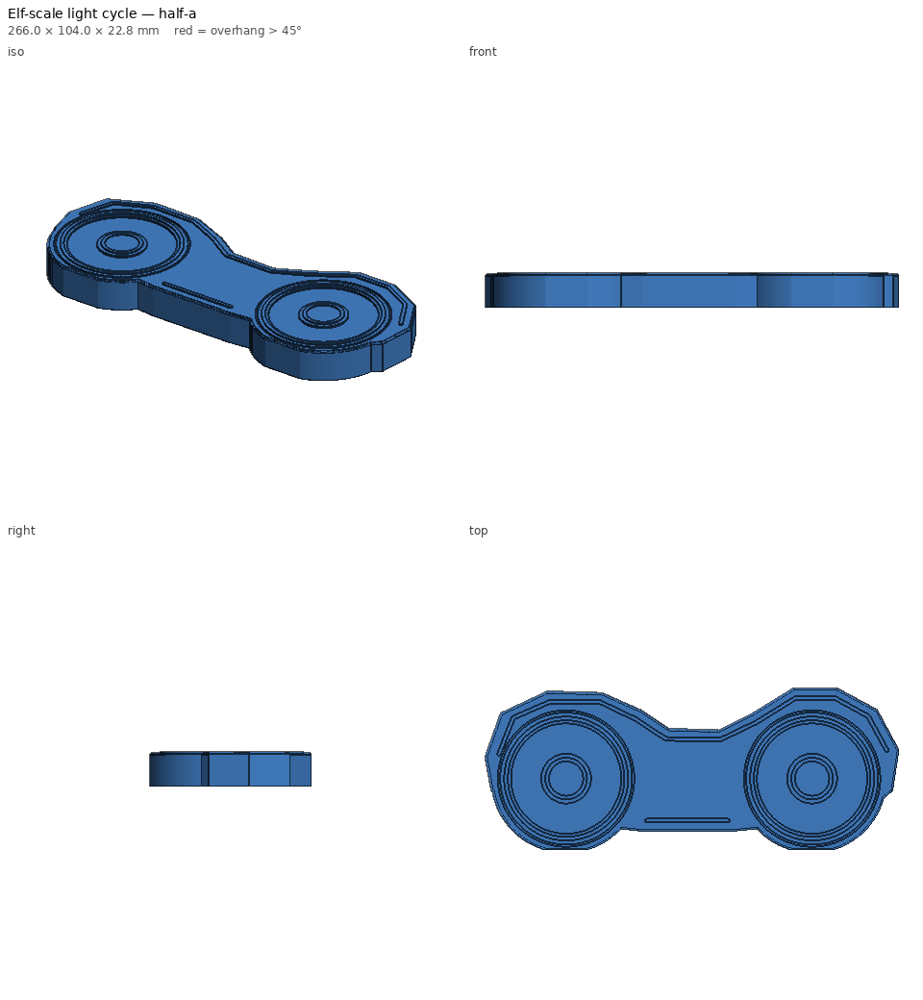

# Elf-scale light cycle

A sleek sci-fi light cycle sized for a ~30 cm shelf elf to ride: about
266 × 46 × 104 mm, with a seat dip ~79 mm up so the elf straddles it with its
legs dangling. Glow stripes and wheel rings are raised on both sides so a
single filament change gives you a black bike with cyan (or orange) lights.



## Parts

| File | Print | Notes |
|---|---|---|
| `light-cycle-half-a.stl` | flat, as exported | one side of the bike |
| `light-cycle-half-b.stl` | flat, as exported | the mirrored other side |
| `light-cycle-trail.stl` | upright, as exported | optional free-standing L-shaped light wall |

Both halves fit on one plate (~266 × 220 mm). No supports, no brim.

## Two-colour lights

Every stripe starts above the slab top, so: start in **black**, and in Anycubic
Slicer Next drag the preview slider to the first layer above **Z = 22.0 mm**,
right-click → *Add color change* (or *Add pause*), and swap to **cyan** PLA
(orange for the villain look). Only the stripes and wheel rings print in the
second colour. Print the trail in translucent or glow-in-the-dark PLA.

## Assembly

1. Cut three ~11 mm pieces of 1.75 mm filament.
2. Push them into the pin holes on the flat (inner) face of one half — one in
   each wheel hub, one mid-body.
3. Press the other half on, check the outlines line up, then glue (CA, or a
   thin layer of PLA-safe glue). Clamp or weight it for a few minutes.

## Parameters

| Param | Default | Notes |
|---|---|---|
| `scale` | 1.0 | 0.5 makes a ~13 cm desk toy (for a smaller figure) |
| `half_width` | 22 | thickness of each half; bike width ≈ 2× this + stripes |
| `line_height` | 0.8 | raised stripe height (4 layers) |
| `line_width` | 2.4 | stripe width |
| `pin_d` | 1.75 | alignment pin diameter (filament) |
| `trail` | true | export the light-wall trail |
| `trail_height` | 45 | wall height |

```bash
python -m printlib build light-cycle --set scale=0.5 --out scratch/mini-cycle
```

If you change `half_width`, the colour-change height changes with it (it's
`half_width × scale`).

See [PRINT.md](PRINT.md) for time, filament and the printability report.
