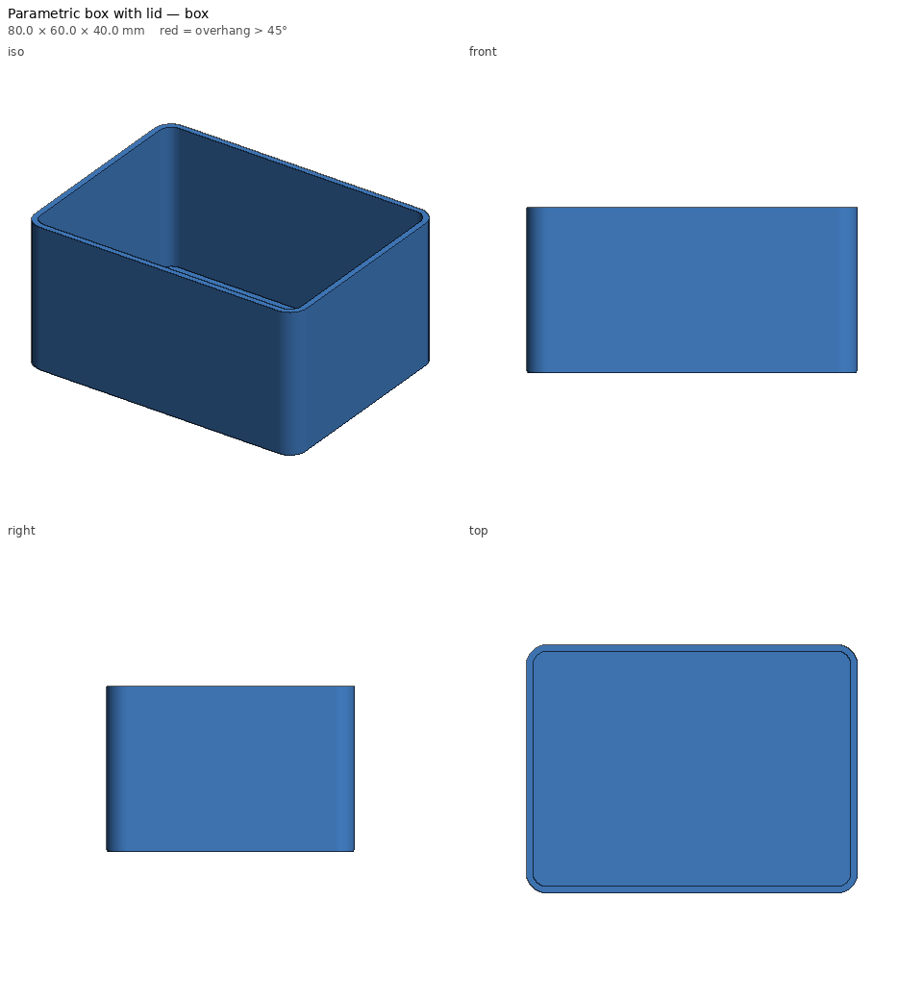
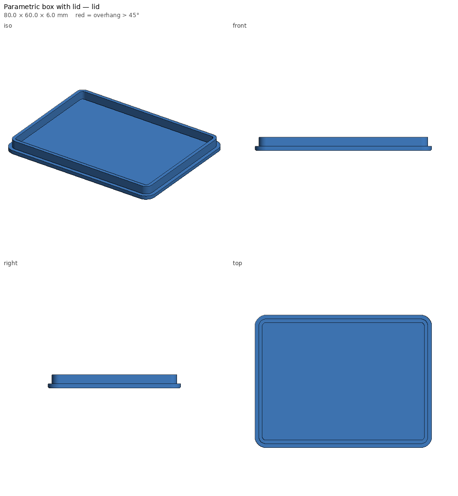

# Parametric box with lid — print notes

_Generated by `printlib build`; do not edit by hand._

**Printer:** Anycubic Kobra 2 Plus · **Material:** PLA · **Nozzle** 210 °C · **Bed** 60 °C · **Layer** 0.2 mm · **Infill** 15% · **Supports:** no

Rounded box + lid. Change width/depth/height, walls, dividers, label.

## Notes

- Lid prints top-face-down; the label is engraved into that face.
- Lid fit uses the `snug` tolerance from the printer profile; use --set fit=slide for a looser lid.

## Parameters used

| Param | Value |
|---|---|
| `width` | 80.0 |
| `depth` | 60.0 |
| `height` | 40.0 |
| `wall` | 1.6 |
| `floor` | 1.2 |
| `radius` | 5.0 |
| `lid_t` | 2.0 |
| `lip_h` | 4.0 |
| `fit` | snug |
| `dividers_x` | 0 |
| `label` |  |

## `parametric-box-box.stl`

| Stat | Value |
|---|---|
| dimensions (mm) | 80.00 x 60.00 x 40.00 |
| triangles | 1,596 |
| volume (cm³) | 22.24 |
| est. PLA (g) | 27.6 |
| est. filament (m) | 9.25 |
| est. print time | 43m |
| bed contact (mm²) | 4670 |
| overhang area (mm²) | 108 |

- ℹ️ **fits** — Fits the Anycubic Kobra 2 Plus usable volume [310, 310, 390].
- ℹ️ **minor-overhang** — 108 mm² of tiny ledges/roofs (stair steps, small holes, lettering) — print fine unsupported.

## `parametric-box-lid.stl`

| Stat | Value |
|---|---|
| dimensions (mm) | 80.00 x 60.00 x 6.00 |
| triangles | 1,996 |
| volume (cm³) | 11.16 |
| est. PLA (g) | 13.8 |
| est. filament (m) | 4.64 |
| est. print time | 22m |
| bed contact (mm²) | 4670 |
| overhang area (mm²) | 108 |

- ℹ️ **fits** — Fits the Anycubic Kobra 2 Plus usable volume [310, 310, 390].
- ℹ️ **minor-overhang** — 108 mm² of tiny ledges/roofs (stair steps, small holes, lettering) — print fine unsupported.
