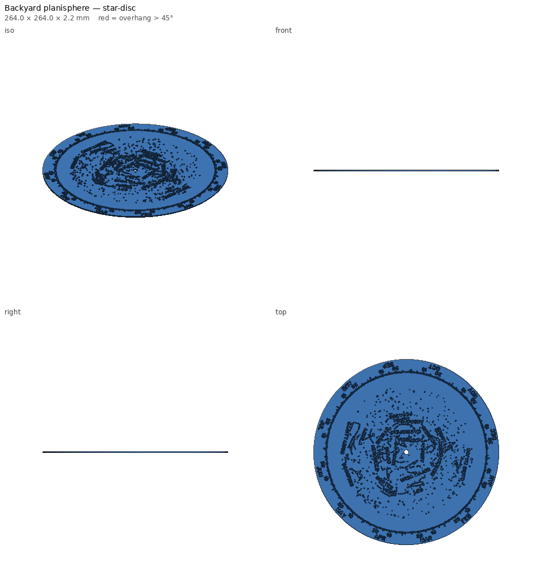
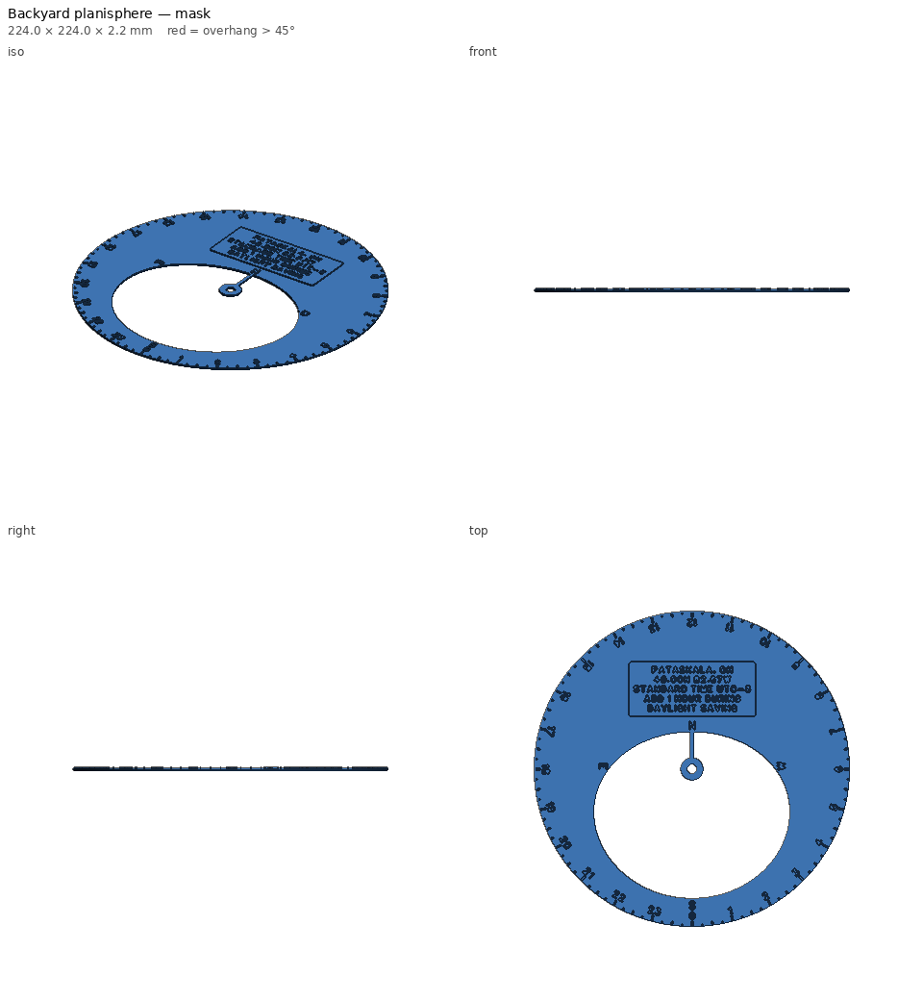
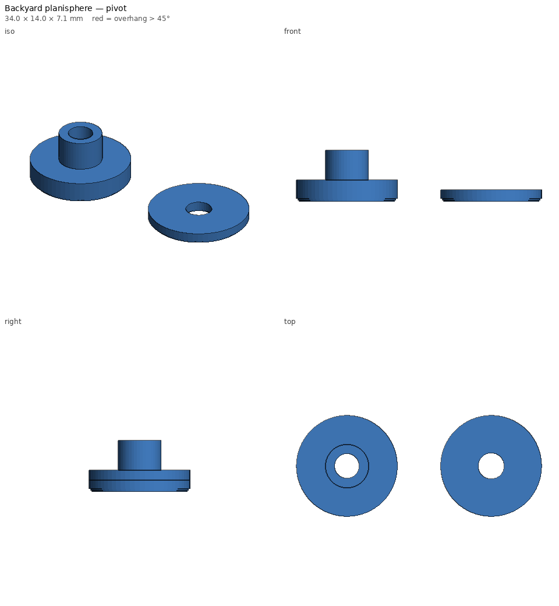

# Backyard planisphere — print notes

_Generated by `printlib build`; do not edit by hand._

**Printer:** Anycubic Kobra 2 Plus · **Material:** PLA · **Nozzle** 210 °C · **Bed** 60 °C · **Layer** 0.2 mm · **Infill** 15% · **Supports:** no

Two-disc star wheel for one site, with a mask window cut to the measured horizon.

**Optional colour change:** at Z = 1.6 mm (start of layer 9 at 0.2 mm layers) — base colour below, raised details in the second colour. In Anycubic Slicer Next / OrcaSlicer: slice, drag the layer slider to that layer, right-click > Add colour change.

## Notes

- Three files: star disc, mask, pivot (flanged sleeve + washer). Hardware: one M3x8 socket-head bolt and one M3 nut.
- Single colour works (everything readable is raised 0.6 mm). For two colours, print dark and change to white/yellow at Z = 1.6 mm on the star disc and the mask (Anycubic Slicer Next: right-click the layer slider > Add colour change).
- Assembly: nut into the sleeve's flange from below, sleeve up through the star disc then the mask, washer on top, bolt down. Snug the bolt; the sleeve carries the clamp so the discs still turn.
- Polaris is within 0.6 deg of the pole, so it sits under the pivot hub.

## Parameters used

| Param | Value |
|---|---|
| `site_file` | site.yaml |
| `mag_limit` | 4.5 |
| `constellations` | ['UMa', 'UMi', 'Cas', 'Cep', 'Dra', 'Cyg', 'Lyr', 'Aql', 'Her', 'Boo', 'Leo', 'Vir', 'Sco', 'Sgr', 'Ori', 'Tau', 'Gem', 'Aur', 'Per', 'And', 'Peg', 'CMa'] |
| `star_disc_d` | 264.0 |
| `mask_d` | 224.0 |
| `base_t` | 1.6 |
| `relief` | 0.6 |
| `chart_margin_deg` | 4.0 |
| `name_size` | 4.0 |

## `planisphere-star-disc.stl`

| Stat | Value |
|---|---|
| dimensions (mm) | 264.00 x 264.00 x 2.20 |
| triangles | 258,064 |
| volume (cm³) | 90.33 |
| est. PLA (g) | 112.0 |
| est. filament (m) | 37.55 |
| est. print time | 2h 49m |
| bed contact (mm²) | 54372 |
| overhang area (mm²) | 331 |

- ℹ️ **fits** — Fits the Anycubic Kobra 2 Plus usable volume [310, 310, 390].
- ℹ️ **minor-overhang** — 331 mm² of tiny ledges/roofs (stair steps, small holes, lettering) — print fine unsupported.

## `planisphere-mask.stl`

| Stat | Value |
|---|---|
| dimensions (mm) | 224.00 x 224.00 x 2.20 |
| triangles | 73,590 |
| volume (cm³) | 44.64 |
| est. PLA (g) | 55.4 |
| est. filament (m) | 18.56 |
| est. print time | 1h 24m |
| bed contact (mm²) | 26206 |
| overhang area (mm²) | 476 |

- ℹ️ **fits** — Fits the Anycubic Kobra 2 Plus usable volume [310, 310, 390].
- ℹ️ **minor-overhang** — 476 mm² of tiny ledges/roofs (stair steps, small holes, lettering) — print fine unsupported.

## `planisphere-pivot.stl`

| Stat | Value |
|---|---|
| dimensions (mm) | 34.00 x 14.00 x 7.10 |
| triangles | 3,288 |
| volume (cm³) | 0.68 |
| est. PLA (g) | 0.8 |
| est. filament (m) | 0.28 |
| est. print time | 3m |
| bed contact (mm²) | 229 |
| overhang area (mm²) | 59 |

- ℹ️ **multi-body** — 2 separate bodies — fine for a plate of parts; make sure each one touches the bed.
- ℹ️ **fits** — Fits the Anycubic Kobra 2 Plus usable volume [310, 310, 390].
- ℹ️ **minor-overhang** — 39 mm² of tiny ledges/roofs (stair steps, small holes, lettering) — print fine unsupported.
- ℹ️ **bridge** — 1 bridge(s), longest 1.5 mm — OK with good cooling.
