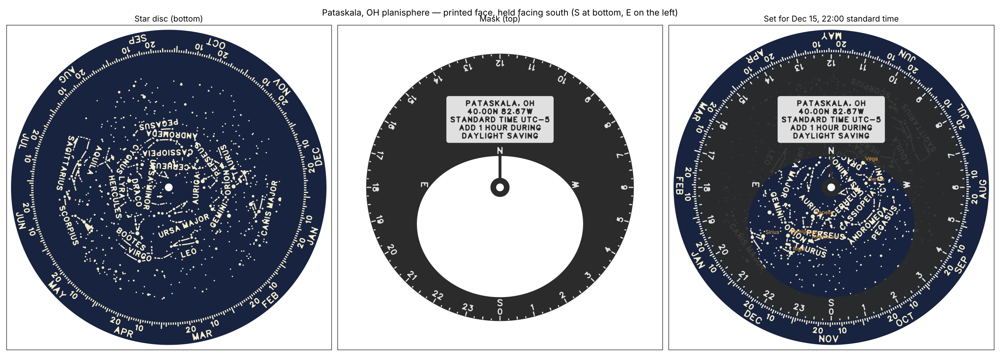

# Backyard planisphere (star wheel)

A two-disc planisphere made for **Pataskala, OH (40.00° N, 82.67° W,
America/New_York)**. The window is cut to your own horizon profile and the time
scale reads standard clock time directly.



## Parts

| File | What | Size | Print |
|---|---|---|---|
| `planisphere-star-disc.stl` | Star chart, constellation lines and names, date scale | Ø 264 × 2.2 mm | ~2 h 50 m, ~112 g |
| `planisphere-mask.stl` | Horizon window, N/E/S/W, 24 h time scale, site plaque | Ø 224 × 2.2 mm | ~1 h 25 m, ~55 g |
| `planisphere-pivot.stl` | Flanged sleeve (traps an M3 nut) + top washer | 34 × 14 × 7.1 mm | ~3 m |

**Hardware:** one M3×8 socket-head bolt and one M3 nut.

- **Single colour:** everything readable is raised 0.6 mm, so it reads by
  light and shadow.
- **Two colours:** start in a dark colour and switch to a light one at
  **Z = 1.6 mm (start of layer 9)**. In Anycubic Slicer Next, slice, drag the
  layer slider to that layer, right-click and choose Add colour change. Do
  this on both discs.
- **Text and gaps:** every text stroke, line and gap is at least 0.9 mm (two
  nozzle widths, and the profile's minimum wall). A test enforces this.

**Assembly:** press the nut into the flange from below. Push the sleeve up
through the star disc (chart up), then the mask (plaque up). Put the washer on
top, then the bolt. Tighten it snug: the bolt clamps the sleeve, not the discs.
The sleeve is 0.3 mm longer than the disc stack, so the discs turn freely but
don't flop.

## How to read it

1. Turn the star disc until **today's date** (outer ring) lines up with the
   **current time** on the mask's edge. The time scale is **standard time**:
   during daylight saving, subtract 1 hour from your clock first (the mask
   reminds you).
   - After midnight, use the **previous evening's** date. The date marks are
     set for the midnight that ends each date.
2. Face the direction you want to look, and hold the wheel up in front of you
   or overhead, **printed side toward you, with that direction's letter at the
   bottom**. Facing south with S at the bottom, east is on your left, just as
   in the sky.
3. The window shows what's above your horizon. The window edge is your
   horizon, and the middle of the window is overhead.

The mask's hub hides the area within ~12° of the pole, which includes Polaris
(0.6° from the pole). A thin bar holds the hub to the north edge of the window.

## Regenerating for a new site or horizon

Everything about the site lives in [`site.yaml`](site.yaml):

```yaml
site: {name, latitude_deg, longitude_deg, timezone}
horizon:
  magnetic_declination_deg: -7.46     # WMM-2025, Pataskala, 2026.8
  altitude_by_azimuth: {0: 0, 15: 0, ...}   # MAGNETIC compass azimuth -> obstruction altitude
```

1. **Measure the horizon.** From your viewing spot, read a compass azimuth
   and the angle up to the top of whatever blocks the sky (a clinometer app
   works), every 15° or wherever the skyline changes. Enter the readings as
   compass (magnetic) azimuths; the model converts them to true north using
   `magnetic_declination_deg`. Between samples it interpolates smoothly with a
   monotone cubic (no invented bumps), wrapping at 360°.
2. **New location?** Change `site`, and recompute the declination:
   `python -c "import pygeomag; print(pygeomag.GeoMag().calculate(glat=LAT, glon=LON, alt=0, time=2026.8).d)"`.
   Northern sites only (the chart is centred on the north celestial pole).
3. Rebuild, test and preview:

   ```bash
   python -m printlib build planisphere
   python -m pytest -q tests/test_planisphere.py
   PYTHONPATH=. python models/planisphere/model.py 2027-01-15 21:00   # preview-overlay.png at a date/time
   python -m printlib bundle planisphere --name planisphere
   ```

With a real horizon, the mask also shows a faint engraved line for the ideal
0° horizon wherever the house or trees hide sky. With today's flat profile it
coincides with the window edge, so there is no line.

Other settings in `model.py`'s `PARAMS` (all accept `--set`):
- `mag_limit` (default 4.5)
- `constellations` (22 by default; add `CrB`, `Cnc`, `Lib`, and others by IAU abbreviation)
- `star_disc_d`, `mask_d`, `base_t`, `relief`, `name_size`

## How it's built (and checked)

- **Projection:** polar azimuthal equidistant, r = k·(90° − δ), with k = 0.657 mm/°.
  The chart runs to δ = −54°, 4° beyond your south horizon at δ = −(90° − φ).
- **Handedness:** derived from first principles (see the `model.py`
  docstring). The mask puts hour angle H at −90° + H, with S at the bottom and
  W on the right. The disc puts RA α at 90° − α, so RA runs clockwise.
  Later dates run clockwise on the disc; later times run counterclockwise on
  the mask.
- **Clock time:** your longitude is 7.67° west of the zone's 75° W meridian,
  so the same sky arrives about **30.7 min later** by the clock. That offset is
  built into the date scale, so the time scale needs no correction.
- **Window:** for each azimuth, (obstruction altitude, azimuth) is converted
  to (H, δ) for your latitude and plotted in the same projection.
- **`tests/test_planisphere.py`** checks the wheel against **astropy**. It
  uses three date/times (Dec 15 22:00, Apr 10 21:30 and Aug 5 23:00, standard
  time) and 13 bright stars with textbook J2000 positions:
  - stars above the horizon must fall inside the window, within 1.5° of their
    true altitude and azimuth (worst case seen is 0.43°)
  - stars below the horizon must fall outside it
  - east must be on the left
  - the date and time scales must turn the right way
  - the longitude correction must be present
  - a measured-horizon bump must move the window, with the declination applied

  Deliberately mirroring the disc or the mask, reversing the time scale, or
  dropping the longitude correction each makes the test fail.
- **Accuracy:** within about 2 minutes of time on the scales. Star positions
  are precessed to J2030, so they're good for roughly 2020–2040.

## Data and licences

- **Stars:** [HYG database v4.1](https://github.com/astronexus/HYG-Database)
  (Yale BSC, Hipparcos and Gliese combined), **CC BY-SA 4.0**.
- **Constellation lines and names:** [Stellarium "modern" sky culture](https://github.com/Stellarium/stellarium/tree/master/skycultures/modern),
  **CC BY-SA 4.0**.
- The reduced CSVs in [`data/`](data/) are derived from those sources and
  are shared under **CC BY-SA 4.0**. Regenerate them with
  `python models/planisphere/prepare_data.py`.
- **Lettering:** Hershey "futural" single-stroke font, via the MIT-licensed
  [Hershey-Fonts](https://github.com/apshu/HersheyFonts) package.
- **Magnetic declination:** NOAA World Magnetic Model 2025, via `pygeomag`.
