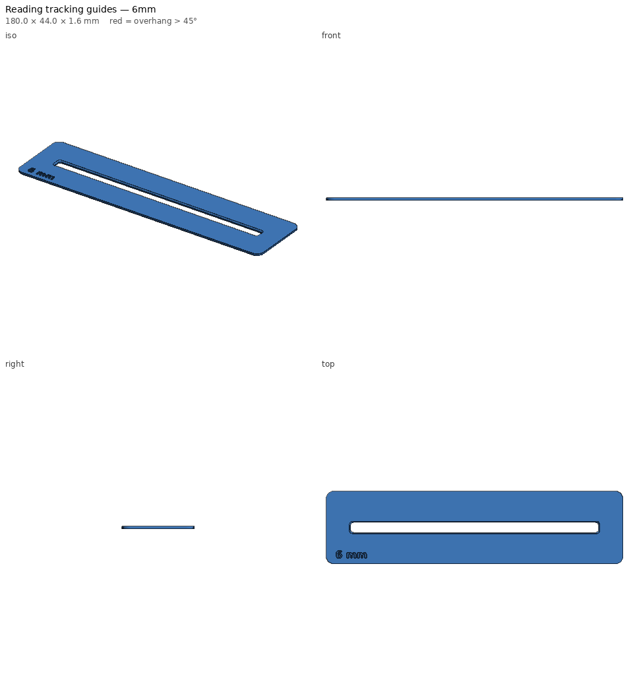
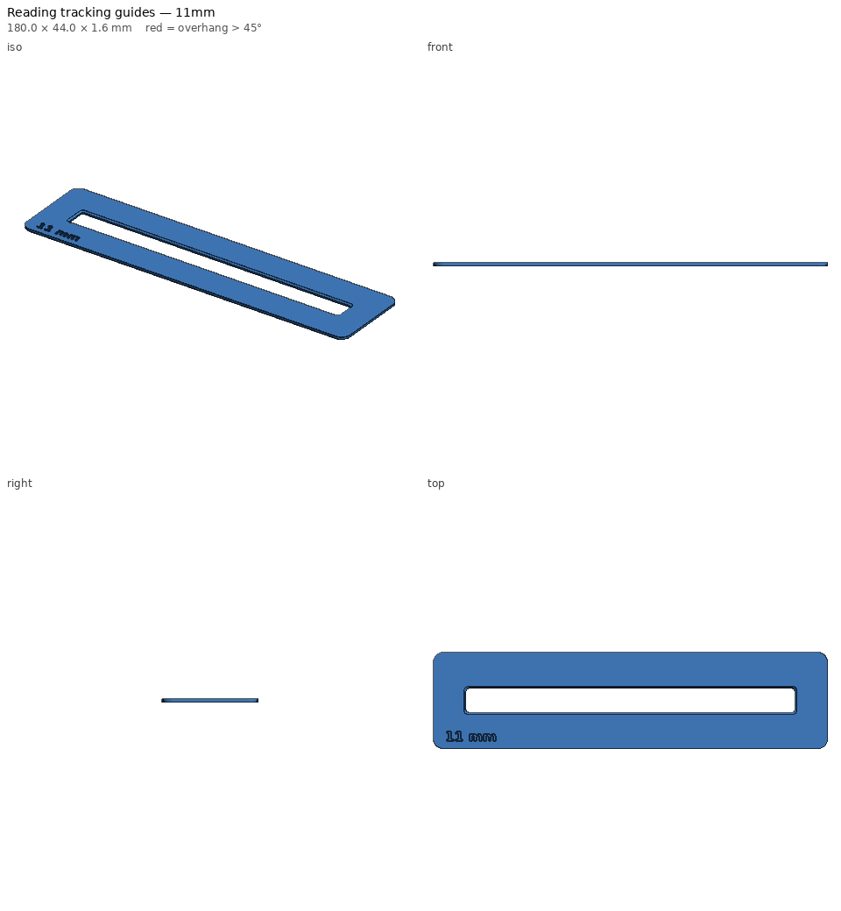

# Reading tracking guides — print notes

_Generated by `printlib build`; do not edit by hand._

**Printer:** Anycubic Kobra 2 Plus · **Material:** PLA · **Nozzle** 210 °C · **Bed** 60 °C · **Layer** 0.2 mm · **Infill** 100% · **Supports:** no

One-line reading windows in several sizes for reading intervention.

## Notes

- Window heights: ~6 mm suits 12 pt text, ~8 mm suits 14-16 pt leveled readers, ~11 mm suits large print.
- Print in a translucent coloured PLA/PETG (yellow, blue or rose) to make the strips double as colour overlays.
- Prints flat as exported; beveled side up is the side you look at.
- Size is engraved in the bottom-left corner so strips stay sorted.

## Parameters used

| Param | Value |
|---|---|
| `window_heights` | [6.0, 8.0, 11.0] |
| `length` | 180.0 |
| `height` | 44.0 |
| `window_len` | 150.0 |
| `thickness` | 1.6 |
| `bevel` | 0.8 |
| `corner_r` | 5.0 |

## `reading-guide-6mm.stl`

| Stat | Value |
|---|---|
| dimensions (mm) | 180.00 x 44.00 x 1.60 |
| triangles | 2,564 |
| volume (cm³) | 11.03 |
| est. PLA (g) | 13.7 |
| est. filament (m) | 4.59 |
| est. print time | 22m |
| bed contact (mm²) | 6825 |
| overhang area (mm²) | 175 |

- ℹ️ **fits** — Fits the Anycubic Kobra 2 Plus usable volume [310, 310, 390].
- ℹ️ **minor-overhang** — 175 mm² of tiny ledges/roofs (stair steps, small holes, lettering) — print fine unsupported.

## `reading-guide-8mm.stl`

| Stat | Value |
|---|---|
| dimensions (mm) | 180.00 x 44.00 x 1.60 |
| triangles | 2,624 |
| volume (cm³) | 10.55 |
| est. PLA (g) | 13.1 |
| est. filament (m) | 4.39 |
| est. print time | 21m |
| bed contact (mm²) | 6525 |
| overhang area (mm²) | 175 |

- ℹ️ **fits** — Fits the Anycubic Kobra 2 Plus usable volume [310, 310, 390].
- ℹ️ **minor-overhang** — 175 mm² of tiny ledges/roofs (stair steps, small holes, lettering) — print fine unsupported.

## `reading-guide-11mm.stl`

| Stat | Value |
|---|---|
| dimensions (mm) | 180.00 x 44.00 x 1.60 |
| triangles | 2,456 |
| volume (cm³) | 9.82 |
| est. PLA (g) | 12.2 |
| est. filament (m) | 4.08 |
| est. print time | 20m |
| bed contact (mm²) | 6075 |
| overhang area (mm²) | 175 |

- ℹ️ **fits** — Fits the Anycubic Kobra 2 Plus usable volume [310, 310, 390].
- ℹ️ **minor-overhang** — 175 mm² of tiny ledges/roofs (stair steps, small holes, lettering) — print fine unsupported.
