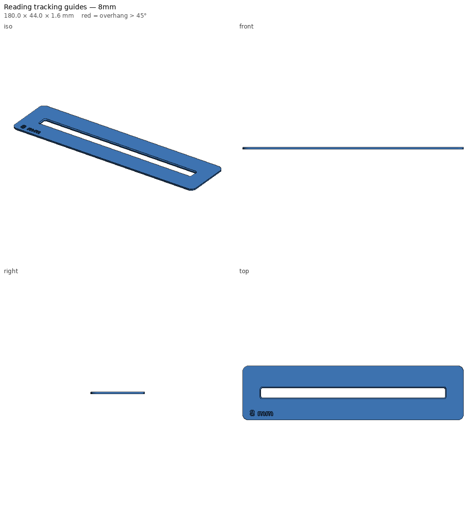

# Reading tracking guides

Flat strips with a one-line window. The student slides the strip down the
page, and only the line being read shows; the lines above and below are
covered. Helpful for students who lose their place, skip lines, or are
overwhelmed by a full page of text.



## The set

| File | Window | Good for |
|---|---|---|
| `reading-guide-6mm.stl` | 6 mm | 12 pt text, typical worksheets and chapter books |
| `reading-guide-8mm.stl` | 8 mm | 14–16 pt text, leveled readers |
| `reading-guide-11mm.stl` | 11 mm | large print |

Each is 180 × 44 mm with a 150 mm window, and the size is engraved in the
corner. The window edge is beveled on the top side so the strip doesn't
shadow the line.

## Printing

- About 20 minutes and 13 g each. Prints flat, no supports.
- **Try translucent coloured filament** (yellow, blue, rose). The strip then
  doubles as a coloured overlay, which some students with visual stress read
  better through.
- Print several of each size so students can take one home.

## Parameters

`window_heights` (list), `length`, `height`, `window_len`, `thickness`, `bevel`, `corner_r`.

```bash
python -m printlib build reading-guide --set "window_heights=[7.0]" --set window_len=120 --out scratch/guide-7
```

See [PRINT.md](PRINT.md).
