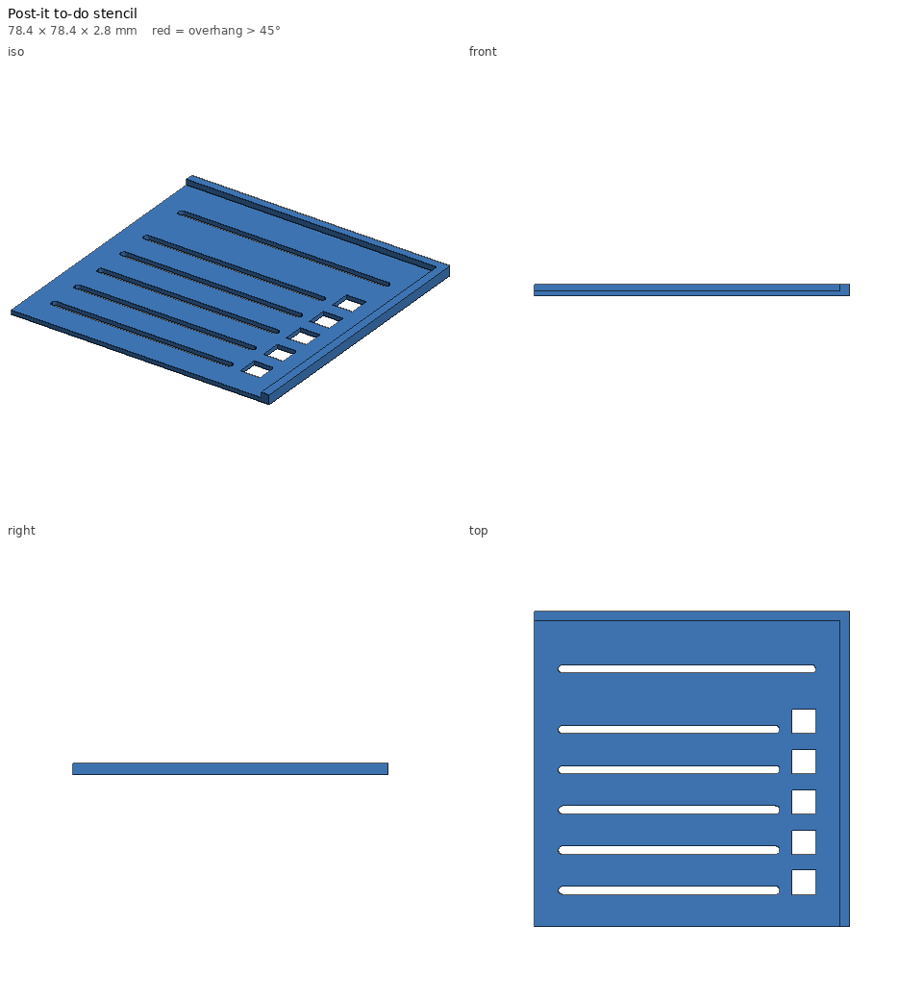

# Post-it to-do stencil — print notes

_Generated by `printlib build`; do not edit by hand._

**Printer:** Anycubic Kobra 2 Plus · **Material:** PLA · **Nozzle** 210 °C · **Bed** 60 °C · **Layer** 0.2 mm · **Infill** 100% · **Supports:** no

Checkbox + line stencil for 76 mm (3") sticky notes, with a corner lip for alignment.

## Notes

- Prints lip-up, as exported; the smooth bed side becomes the pen side.
- Flip it over to use: lip down, hooked over the note's top (sticky) edge and left edge.
- Trace the inside of each square for a checkbox; run the pen along each slot for the line.
- Fine-tip pens (0.5-1 mm) work best. Wipe ink off with alcohol.
- Defaults fit standard 3x3 in (76 mm) notes; set note_w/note_h for other sizes (e.g. 127 x 76 for 3x5).

## Parameters used

| Param | Value |
|---|---|
| `note_w` | 76.0 |
| `note_h` | 76.0 |
| `rows` | 5 |
| `box_size` | 6.0 |
| `slot_w` | 2.0 |
| `margin` | 6.0 |
| `title_line` | True |
| `title_gap` | 16.0 |
| `thickness` | 1.2 |
| `lip_h` | 1.6 |
| `lip_w` | 2.4 |

## `todo-stencil.stl`

| Stat | Value |
|---|---|
| dimensions (mm) | 78.40 x 78.40 x 2.80 |
| triangles | 2,558 |
| volume (cm³) | 6.95 |
| est. PLA (g) | 8.6 |
| est. filament (m) | 2.89 |
| est. print time | 14m |
| bed contact (mm²) | 5294 |
| overhang area (mm²) | 0 |

- ℹ️ **fits** — Fits the Anycubic Kobra 2 Plus usable volume [310, 310, 390].
- ℹ️ **no-supports** — No overhangs beyond the limit — prints without supports.
