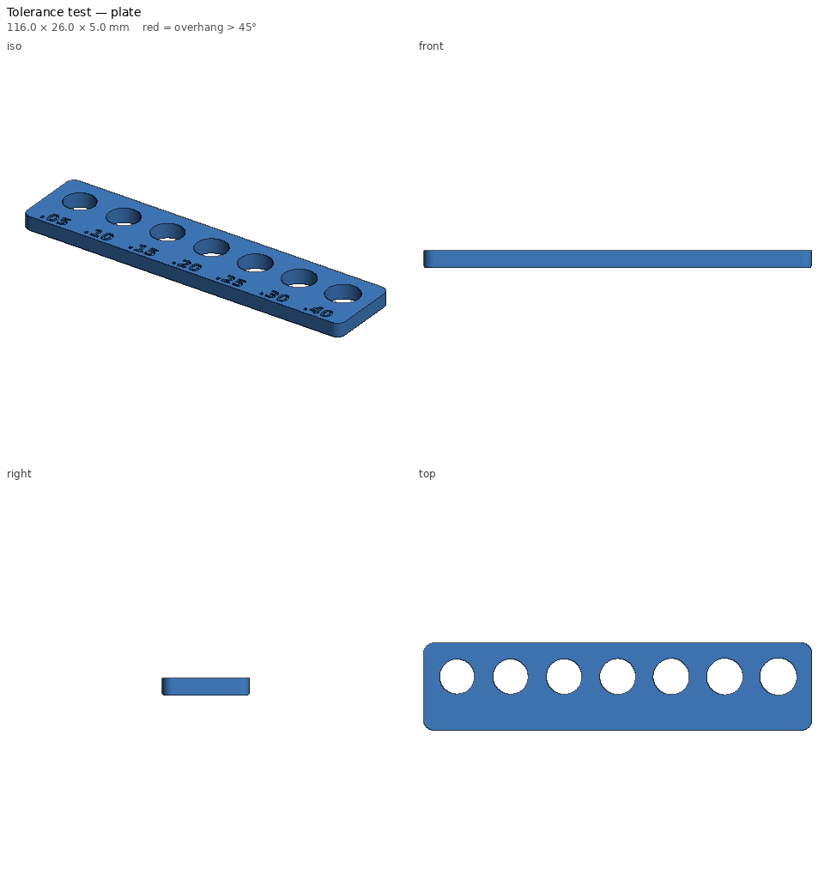
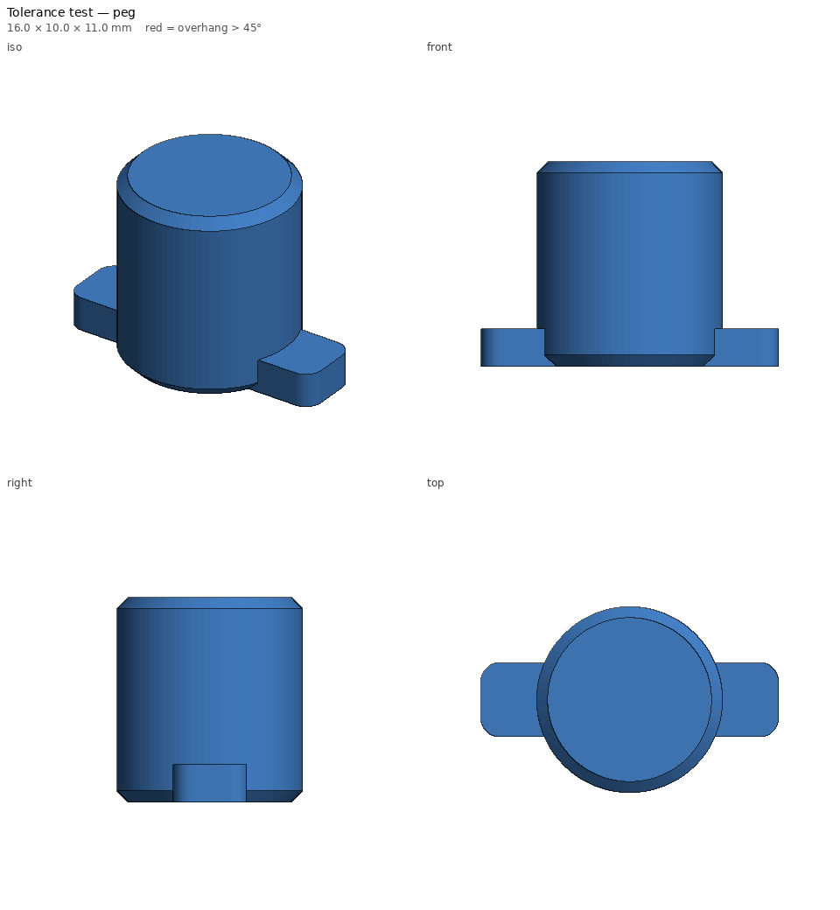

# Tolerance test — print notes

_Generated by `printlib build`; do not edit by hand._

**Printer:** Anycubic Kobra 2 Plus · **Material:** PLA · **Nozzle** 210 °C · **Bed** 60 °C · **Layer** 0.2 mm · **Infill** 20% · **Supports:** no

Peg + hole plate with labelled per-side clearances for calibrating fits.

## Notes

- Print both parts with the same material/settings you plan to use for real parts.
- Numbers engraved under each hole are the per-side clearance in mm.
- Update `tolerances:` in printlib/profiles/kobra2plus.yaml with what you find.

## Parameters used

| Param | Value |
|---|---|
| `peg_d` | 10.0 |
| `clearances` | [0.05, 0.1, 0.15, 0.2, 0.25, 0.3, 0.4] |
| `plate_t` | 5.0 |
| `pitch` | 16.0 |

## `tolerance-test-plate.stl`

| Stat | Value |
|---|---|
| dimensions (mm) | 116.00 x 26.00 x 5.00 |
| triangles | 5,732 |
| volume (cm³) | 11.79 |
| est. PLA (g) | 11.8 |
| est. filament (m) | 3.97 |
| est. print time | 19m |
| bed contact (mm²) | 2266 |
| overhang area (mm²) | 111 |

- ℹ️ **fits** — Fits the Anycubic Kobra 2 Plus usable volume [310, 310, 390].
- ℹ️ **minor-overhang** — 111 mm² of tiny ledges/roofs (stair steps, small holes, lettering) — print fine unsupported.

## `tolerance-test-peg.stl`

| Stat | Value |
|---|---|
| dimensions (mm) | 16.00 x 10.00 x 11.00 |
| triangles | 1,266 |
| volume (cm³) | 0.90 |
| est. PLA (g) | 0.9 |
| est. filament (m) | 0.30 |
| est. print time | 3m |
| bed contact (mm²) | 90 |
| overhang area (mm²) | 0 |

- ℹ️ **fits** — Fits the Anycubic Kobra 2 Plus usable volume [310, 310, 390].
- ℹ️ **no-supports** — No overhangs beyond the limit — prints without supports.
