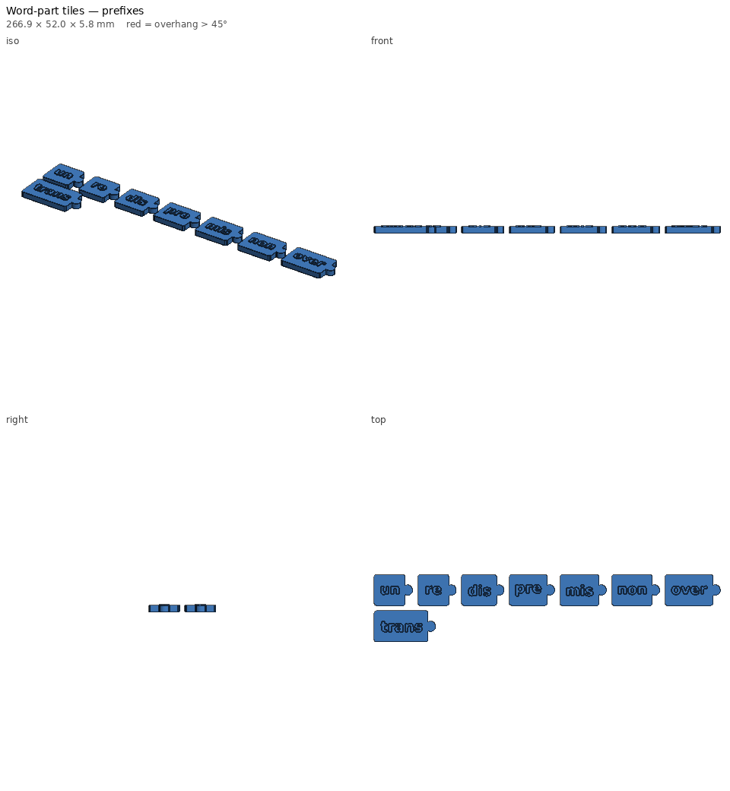
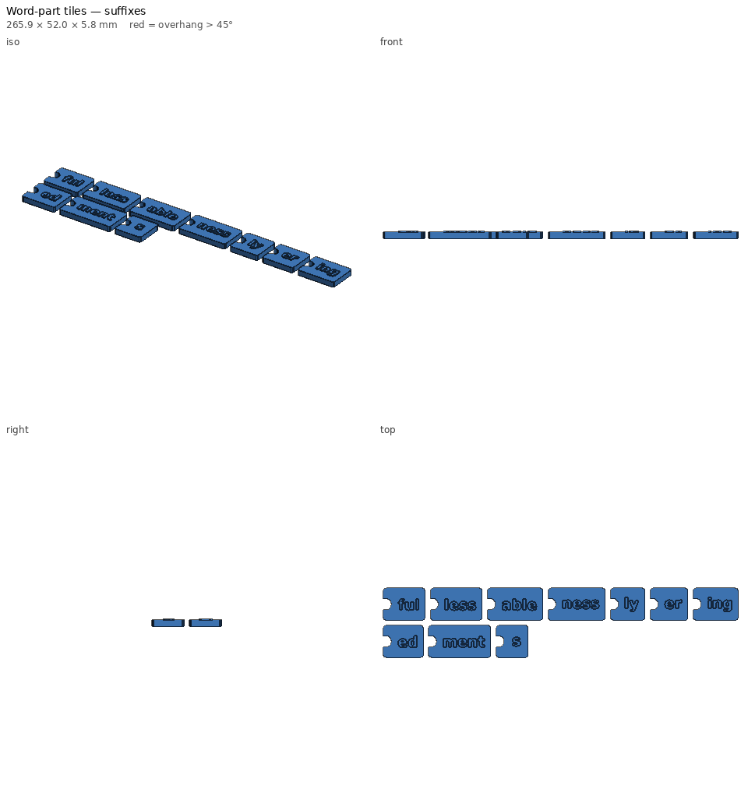

# Word-part tiles — print notes

_Generated by `printlib build`; do not edit by hand._

**Printer:** Anycubic Kobra 2 Plus · **Material:** PLA · **Nozzle** 210 °C · **Bed** 60 °C · **Layer** 0.2 mm · **Infill** 15% · **Supports:** no

Connecting prefix / base-word / suffix tiles for morphology and decoding practice.

## Notes

- Print prefixes, bases and suffixes in three different colours.
- Tiles lie flat; the jigsaw connectors join by pressing one tile down onto the next.
- Word lists are parameters — edit them for this week's lesson and rebuild.
- Example words: un-help-ful, re-use-able, dis-agree-ment, pre-view, trans-port, play-er, kind-ness.
- Raised letters are 0.8 mm tall so students can trace them with a finger.

## Parameters used

| Param | Value |
|---|---|
| `prefixes` | ['un', 're', 'dis', 'pre', 'mis', 'non', 'over', 'trans'] |
| `bases` | ['help', 'play', 'kind', 'read', 'use', 'agree', 'view', 'lock', 'port', 'form'] |
| `suffixes` | ['ful', 'less', 'able', 'ness', 'ly', 'er', 'ing', 'ed', 'ment', 's'] |
| `text_size` | 8.0 |
| `tile_h` | 24.0 |
| `tile_t` | 5.0 |
| `text_raise` | 0.8 |
| `knob_d` | 8.0 |
| `knob_reach` | 6.0 |
| `fit` | slide |
| `plate_width` | 290.0 |

## `word-part-tiles-prefixes.stl`

| Stat | Value |
|---|---|
| dimensions (mm) | 266.87 x 52.00 x 5.80 |
| triangles | 36,372 |
| volume (cm³) | 31.21 |
| est. PLA (g) | 28.0 |
| est. filament (m) | 9.37 |
| est. print time | 43m |
| bed contact (mm²) | 5787 |
| overhang area (mm²) | 364 |

- ℹ️ **multi-body** — 8 separate bodies — fine for a plate of parts; make sure each one touches the bed.
- ℹ️ **fits** — Fits the Anycubic Kobra 2 Plus usable volume [310, 310, 390].
- ℹ️ **minor-overhang** — 364 mm² of tiny ledges/roofs (stair steps, small holes, lettering) — print fine unsupported.

## `word-part-tiles-bases.stl`

| Stat | Value |
|---|---|
| dimensions (mm) | 264.17 x 52.00 x 5.80 |
| triangles | 65,248 |
| volume (cm³) | 50.94 |
| est. PLA (g) | 45.5 |
| est. filament (m) | 15.24 |
| est. print time | 1h 09m |
| bed contact (mm²) | 9452 |
| overhang area (mm²) | 582 |

- ℹ️ **multi-body** — 10 separate bodies — fine for a plate of parts; make sure each one touches the bed.
- ℹ️ **fits** — Fits the Anycubic Kobra 2 Plus usable volume [310, 310, 390].
- ℹ️ **minor-overhang** — 582 mm² of tiny ledges/roofs (stair steps, small holes, lettering) — print fine unsupported.

## `word-part-tiles-suffixes.stl`

| Stat | Value |
|---|---|
| dimensions (mm) | 265.93 x 52.00 x 5.80 |
| triangles | 49,796 |
| volume (cm³) | 39.33 |
| est. PLA (g) | 35.6 |
| est. filament (m) | 11.94 |
| est. print time | 55m |
| bed contact (mm²) | 7281 |
| overhang area (mm²) | 482 |

- ℹ️ **multi-body** — 10 separate bodies — fine for a plate of parts; make sure each one touches the bed.
- ℹ️ **fits** — Fits the Anycubic Kobra 2 Plus usable volume [310, 310, 390].
- ℹ️ **minor-overhang** — 482 mm² of tiny ledges/roofs (stair steps, small holes, lettering) — print fine unsupported.
