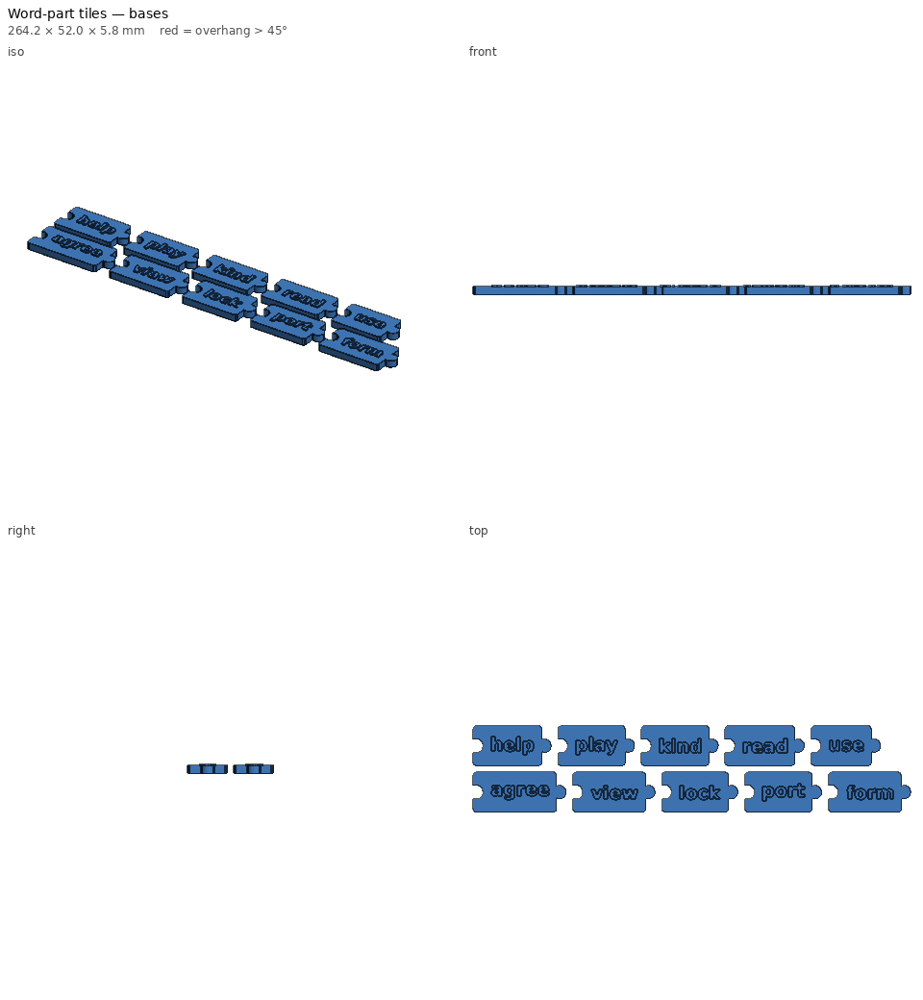

# Word-part tiles

Prefix, base-word and suffix tiles that connect like puzzle pieces, for
building and breaking apart multisyllabic words (morphology and decoding).



## The connector shape is the grammar

- **Prefixes** have a knob on the right only.
- **Base words** have a socket on the left and a knob on the right.
- **Suffixes** have a socket on the left only.

So `un + help + ful` fits together, but a prefix can't go after a base and
nothing attaches after a suffix. Students get physical feedback about where
each word part goes.

## Default word lists

| Prefixes | Bases | Suffixes |
|---|---|---|
| un, re, dis, pre, mis, non, over, trans | help, play, kind, read, use, agree, view, lock, port, form | ful, less, able, ness, ly, er, ing, ed, ment, s |

Some words they make: unhelpful, helpless, replay, player, unkind, kindness,
reread, misread, readable, reuse, useful, disagree, agreement, preview,
viewer, unlock, transport, report, portable, reform, transform, overuse.

Some combinations change spelling (use + able → *usable*). That makes a
good teaching moment: build it, then write it.

## Printing

- Three files, about 2¾ hours and 110 g in total. Print each category in its **own
  colour** (for example prefixes green, bases white or yellow, suffixes blue).
- Raised 0.8 mm letters can be traced with a finger.
- Joints use the `slide` fit from the printer profile; press one tile down
  onto the other. If they're tight, print the tolerance test and adjust.

## Make this week's set

```bash
python -m printlib build word-part-tiles \
  --set "prefixes=['in', 'im', 'sub']" \
  --set "bases=['port', 'ject', 'rupt', 'struct']" \
  --set "suffixes=['ion', 'or', 'ive']" --out scratch/latin-roots
```

See [PRINT.md](PRINT.md).
